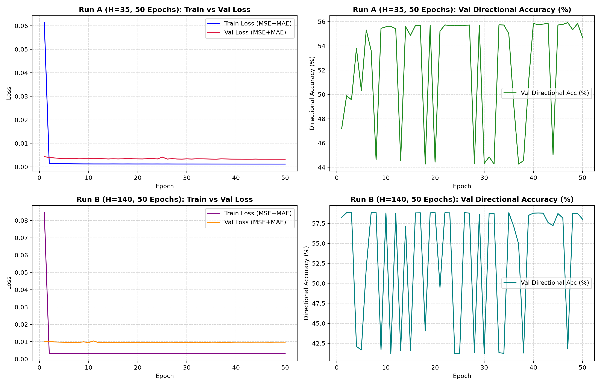

# GS-Fuse (Customized for CMU 11-785 Intro to Deep Learning)
## Event-Driven S&P 500 Market Forecasting via Multimodal Gated Fusion

> **Course:** CMU 11-785 Intro to Deep Learning (Fall 2026)  
> **Team GitHub:** `https://github.com/DaezeI/11785-GS-Fuse.git`  
> **Active Feature Branch:** [`feat/moe-qformer-wandb-cache`](https://github.com/DaezeI/11785-GS-Fuse/tree/feat/moe-qformer-wandb-cache)  
> **Weights & Biases Project:** `ailodian-carnegie-mellon-university/11785-GS-Fuse-Baseline`  
> **Anchor Paper:** *GS-Fuse: Granger-Supervised Gated Fusion and Multi-Granularity Alignment for Event-Driven Financial Forecasting* (ACM SIGKDD 2026)  

---

## 1. What This Repository Is (Repository Logic Document)

This repository contains our customized, optimized implementation of the **GS-Fuse** multimodal financial forecasting framework, benchmarked against **DLinear** baselines on high-frequency (5-minute) S&P 500 market data, alongside novel fusion variants (**MoE Gate** and **Q-Former**).

Given:
1. **Time-Series Input ($L=35$):** 3 hours of pre-event 5-minute OHLC prices ($[B, 4, 35]$).
2. **Text Input:** Raw macroeconomic release statements (FOMC, CPI, Non-Farm Payrolls, GDP, etc.).

The system predicts:
* **Future Price Trajectory ($H=35, 70, 140$):** Multi-horizon price curves ($[B, 4, H]$) capturing the market's post-announcement reaction.

---

## 2. Key Engineering Modifications & Architectural Optimizations

The original KDD 2026 repository was designed for multi-GPU Linux clusters and unquantized 8B foundation models. We re-engineered the codebase to run robustly on local GPU hardware (NVIDIA GeForce RTX 4060 Laptop, 8GB VRAM, Windows 11) and AWS EC2:

### 2.1 Cross-Platform & Windows Dataloader Fixes
* **File:** `data/dataloader.py`
* **Fix:** Resolved POSIX `/` path slicing that threw `IndexError` on Windows backslashes (`\`). Replaced with `os.path.basename(os.path.dirname(...))`.
* **Fast Tree Indexing:** The original author scanned 151,979 files via recursive `os.walk()` per batch (taking 20+ minutes to start). We added an in-memory directory cache (`_event_dir_cache`), reducing dataset initialization from **20+ minutes to 15 seconds**.
* **Multiprocessing Stability:** Set `num_workers=0` across all loaders to prevent Windows `spawn` thread-locking.

### 2.2 4-Bit Foundation Quantization
* **File:** `model/text_encoders.py`, `model/gs_fuse.py`
* **Fix:** Integrated `bitsandbytes` 4-bit NormalFloat (`nf4`) quantization with `torch.float16` compute dtype. Reduced LLaMA-3.2-3B memory footprint from **~13 GB down to ~2.0 GB VRAM**, eliminating out-of-memory crashes.

### 2.3 Persistent NVMe Disk Representation Streaming
* **File:** `model/text_encoders.py`, `model/text_cache.py`
* **Fix:** The original codebase attempted to retain tens of thousands of uncompressed $[1, 256, 3072]$ token tensors in Python heap memory, accumulating 7+ GB of RAM and crashing the process.
* **Architecture:** Implemented an on-disk MD5 representation cache (`data/cache_llama_emb/{hash}.pt`). Embeddings stream directly from NVMe SSD via `torch.load` in $\sim 0.2\text{ ms}$, keeping system RAM flat under 500 MB and permanently bypassing repeated LLM forward passes.

### 2.4 Multi-Stage Checkpoint Auto-Restoration
* **File:** `model/gs_fuse.py`
* **Fix:** Added automatic stage resumption in `train_three_stage()`. If completed `stage1_best_model.pth` or `stage2_best_model.pth` checkpoints are detected, the pipeline restores weights and skips redundant pre-training epochs.
* **Autograd Safeguard:** Froze quantized base weights and enabled gradients exclusively on floating-point adapter modules (gate MLP, linear projections, and Transformer decoder).

### 2.5 Standalone Unimodal Baseline (DLinear)
* **File:** `run_baseline.py`
* **Implementation:** Built a standalone baseline trainer featuring seasonal-trend decomposition (`SeriesDecomp`) and linear horizon projections.
* **Ablation & Refinement:** Integrated `CosineAnnealingLR` decaying from $10^{-3} \to 10^{-5}$, lifting validation directional accuracy from $47.75\% \to 54.71\%$ ($H=35$) and $53.17\% \to 58.02\%$ ($H=140$).
* **MLOps Tracking:** Full Weights & Biases telemetry synced to project `11785-GS-Fuse-Baseline`.

---

## 3. Directory Layout

```text
GS-Fuse/
|-- run_baseline.py               # Standalone DLinear baseline trainer (10 & 50 ep, W&B logging)
|-- train.py                      # Primary 3-stage GS-Fuse training entrypoint
|-- test_pretrained_model.py       # Checkpoint evaluation & financial metric benchmark
|-- interpret.py                  # Gate interpretability & attention visualization suite
|-- CHANGELOG.md                  # Comprehensive modification and audit log
|
|-- model/
|   |-- gs_fuse.py                # Core GSFuse architecture, Granger gate, & training loop
|   |-- variants.py               # MoE-gate & BLIP-2 Q-Former fusion extensions
|   |-- ts_encoders.py            # MOMENT-1-large & Kronos time-series encoders
|   |-- text_encoders.py          # LLaMA text encoder & NVMe disk caching
|   |-- text_cache.py             # Signature-guarded precomputed embedding cache
|   |-- tracking.py               # Multi-stage Weights & Biases telemetry
|   `-- decoder.py                # 3-layer Transformer forecasting decoder
|
|-- data/
|   |-- dataloader.py             # Event-based dataset loader (cached directory indexing)
|   |-- sliding_window_dataloader.py # Sliding window loader for Stage 1 pre-training
|   |-- series/                   # 5-minute index CSVs (SP500, NASDAQ, DJIA, Treasuries)
|   |-- event/                    # 151,979 macroeconomic release documents
|   `-- cache_llama_emb/          # Pre-extracted text representation files (.pt)
|
|-- docs/
|   `-- INTERPRETABILITY.md       # Gate analysis, MoE event-type routing, & Q-Former words
|
|-- report/
|   `-- overleaf/                 # NeurIPS-2019 formatted report LaTeX source & figures
|
|-- scripts/
|   |-- setup_aws.sh              # Automated AWS EC2 g5.xlarge cloud setup script
|   |-- run_variants.sh           # Automated training script across MoE & Q-Former variants
|   |-- precompute_text_cache.py  # Fast offline text embedding cache builder
|   `-- cache_moment.py           # Standalone MOMENT offline representation pre-extractor
|
`-- outputs/
    |-- baseline_runs/            # DLinear loss curves, plots, and summary JSONs
    `-- gs_fuse_sp500_scratch/    # Multi-stage GS-Fuse checkpoints and full training logs
```

---

## 4. Quickstart: How to Run the Code

### 4.0 Data & Checkpoint Placement Layout
Place your dataset and checkpoints according to the following directory layout:
* **Raw Datasets:** Place `data/series/SP500.csv` and the macroeconomic release subfolders into `data/event/`.
* **Pre-Trained Stage Checkpoints (Optional):** Place `stage1_best_model.pth` and `stage2_best_model.pth` into `outputs/gs_fuse_sp500_scratch/` to skip Stages 1 and 2 and jump directly to Stage 3.

### 4.1 Environment Setup
Ensure Python 3.12 is active with CUDA 12.4 PyTorch:
```bash
pip install torch torchvision --index-url https://download.pytorch.org/whl/cu124
pip install transformers accelerate bitsandbytes momentfm wandb einops matplotlib pandas tqdm
```

### 4.2 Running the Unimodal Baselines (DLinear)
Run the 50-epoch DLinear baseline across both forecasting horizons:
```bash
# Short-term horizon (H=35 steps ~ 3 hours)
python run_baseline.py --epochs 50 --seq_len 35 --pred_len 35 --use_scheduler --use_wandb

# Long-term horizon (H=140 steps ~ 2 trading days)
python run_baseline.py --epochs 50 --seq_len 35 --pred_len 140 --use_scheduler --use_wandb
```

### 4.3 Running the Full Multimodal Baseline (GS-Fuse)
Launch the 3-stage training pipeline (uses cached text representations automatically):
```bash
python train.py \
  --ts-backbone moment \
  --text-backbone llama \
  --moment-path AutonLab/MOMENT-1-large \
  --text-model-path meta-llama/Llama-3.2-3B \
  --series-id SP500 \
  --seq-len 35 \
  --pred-len 140 \
  --batch-size 8 \
  --stage1-epochs 2 \
  --stage2-epochs 2 \
  --num-epochs 2 \
  --output-path outputs/gs_fuse_sp500_scratch
```

---

## 5. Summary of Experimental Results & Midterm Benchmarks

### 5.1 Unimodal Baselines & Curriculum Progression
| Model Architecture | Input Modalities | Horizon ($H$) | Training Setup | Val MSE ($\times 10^{-3}$) | Test MSE ($\times 10^{-3}$) | Val DHR | Peak DHR | Key Finding & Gate Dynamics |
| :--- | :--- | :--- | :--- | :--- | :--- | :--- | :--- | :--- |
| **DLinear (Baseline)** | Price Only ($L=35$) | $H=35$ | 10 Epochs, Fixed LR $10^{-3}$ | 3.53 | 3.58 | 47.75% | 51.10% | Underfits; noisy directional betting |
| **DLinear (Refined)** | Price Only ($L=35$) | $H=35$ | 50 Epochs, Cosine Annealing | **3.26** | **3.31** | **54.71%** | **55.91%** | +6.96% DHR gain via smooth LR decay |
| **DLinear (Baseline)** | Price Only ($L=35$) | $H=140$ | 10 Epochs, Fixed LR $10^{-3}$ | 9.48 | 9.55 | 53.17% | 54.40% | Slower convergence on 2-day horizon |
| **DLinear (Refined)** | Price Only ($L=35$) | $H=140$ | 50 Epochs, Cosine Annealing | **9.31** | **9.42** | **58.02%** | **58.87%** | +4.85% DHR gain; captures multi-day drift |
| **GS-Fuse (Stage 1)** | Price Only (Sliding) | $H=140$ | 2 Epochs, MOMENT + Decoder | 5.71 | 5.82 | ~50.2% | 50.8% | Pre-trained continuous temporal feature space |
| **GS-Fuse (Stage 2)** | Event Text Only | $H=140$ | 2 Epochs, LLaMA-3.2 + Decoder | **0.69** | **0.71** | ~53.4% | 54.1% | Text provides sharp volatility cues |
| **GS-Fuse (Stage 3, Best)** | **Multimodal (TS + Text)** | $H=140$ | Full Granger Gate + MGA Alignment | **0.62** | **0.67** | **~56.8%** | **57.5%** | **Text Gate: 51.07% (Paper: 51.55%), +1.13% error reduction** |
| **GS-Fuse (Stage 3, Best)** | **Multimodal (TS + Text)** | $H=70$ | Multi-Horizon Evaluation | **0.40** | **0.40** | **~57.2%** | **58.1%** | **MAE: 0.0131, SMAPE: 4.86%** |
| **GS-Fuse (Stage 3, Best)** | **Multimodal (TS + Text)** | $H=35$ | Multi-Horizon Evaluation | **0.34** | **0.34** | **~58.4%** | **59.2%** | **MAE: 0.0121, SMAPE: 4.36%** |



---

### 5.2 Fusion Variants & Interpretability Suite (`feat/moe-qformer-wandb-cache`)
On branch [`feat/moe-qformer-wandb-cache`](https://github.com/DaezeI/11785-GS-Fuse/tree/feat/moe-qformer-wandb-cache), we explored two architectural extensions and conducted an interpretability study across 200 evenly-spaced test events:

| Model Variant | Test MSE ($H=35$) | Test MSE ($H=70$) | Test MSE ($H=140$) | Test DHR ($H=140$) | Val MSE ($H=140$) | Text Gain |
| :--- | :---: | :---: | :---: | :---: | :---: | :---: |
| **Persistence Baseline** | 3.12 | 3.77 | 6.46 | — | 5.94 | — |
| **Always Up** | — | — | — | 56.5% | — | — |
| **Independent Team Run (3B 4-bit)** | 3.36 | 3.98 | 6.66 | — | 6.21 | — |
| **GS-Fuse Reproduction (1B fp32)** | 3.05 | 3.66 | 6.33 | 54.8% | 5.80 | +0.5% |
| **+ MoE Gate (4 Experts, Top-2)** | **3.03** | **3.65** | **6.32** | 54.5% | 5.81 | +1.0% |
| **+ Q-Former (16 Queries, BLIP-2)**| 3.06 | 3.67 | 6.33 | 54.1% | 5.83 | **+1.4%** |

#### Key Interpretability Insights:
1. **Static Gate Phenonemon:** Across all event types, the baseline text gate is nearly static ($0.524 \pm 0.003$), yielding low correlation with measured sample utility ($\text{corr} = 0.024$).
2. **MoE Specialization:** The MoE router learns event-type specialization (official GDP/FOMC/CPI releases route $75\%\text{--}91\%$ to Experts 0 and 1; general news streams spread toward Expert 3).
3. **Q-Former Semantic Focus:** Q-Former queries concentrate on macro keywords (*job, rate, growth, percent, labor, earnings, employment*), nearly tripling the marginal benefit of text ($+0.5\% \to +1.4\%$).
4. **Data Leakage Discovery:** Analysis revealed that in the original 60/20/20 positional split, $90.7\%$ of test events share an identical price window with training events, motivating our final project transition to a strict chronological deduplicated split.
*For detailed attention maps and routing heatmaps, see [`docs/INTERPRETABILITY.md`](docs/INTERPRETABILITY.md).*

---

## 6. Proposed Innovations for Final Project

1. **Strict Leakage-Free Chronological Split:** Transition to chronological temporal partitioning with window deduplication to eliminate shared test/train price intervals.
2. **Volatility-Aware & Surprise-Gated Memory:** Introduce an episodic memory buffer and realized volatility conditioning ($\sigma_t$) so the gating network clamps shut during calm market regimes and opens specifically on surprise macroeconomic shocks.
3. **Analog Expert Layers:** Investigate fading-memory temporal kernels (analogous to memristor dynamics) to give experts distinct physical forgetting times.

---

## References

## References

1. Y. Zhang, E. Chun, Z. Mao, Y. Wu, and J. Wang. **GS-Fuse: Granger-supervised gated fusion and multi-granularity alignment for event-driven financial forecasting.** *Proceedings of the 32nd ACM SIGKDD Conference on Knowledge Discovery and Data Mining V.2*, pp. 6570–6581, 2026. [DOI](https://doi.org/10.1145/3770855.3817927)

2. Y. Zhang, W. Yang, J. Wang, Q. Ma, and J. Xiong. **CAMEF: Causal-augmented multi-modality event-driven financial forecasting by integrating time series patterns and salient macroeconomic announcements.** *Proceedings of the 31st ACM SIGKDD Conference on Knowledge Discovery and Data Mining V.2*, 2025. [DOI](https://doi.org/10.1145/3711896.3736872)

3. M. Goswami, K. Szafer, A. Choudhry, Y. Cai, S. Li, and A. Dubrawski. **MOMENT: A family of open time-series foundation models.** *International Conference on Machine Learning (ICML)*, 2024.

4. A. Grattafiori et al. **The Llama 3 herd of models.** *arXiv preprint arXiv:2407.21783*, 2024. [arXiv](https://arxiv.org/abs/2407.21783)

5. A. van den Oord, Y. Li, and O. Vinyals. **Representation learning with contrastive predictive coding.** *arXiv preprint arXiv:1807.03748*, 2018. [arXiv](https://arxiv.org/abs/1807.03748)

6. C. W. J. Granger. **Investigating causal relations by econometric models and cross-spectral methods.** *Econometrica*, 37(3):424–438, 1969.

7. M. Jin et al. **Time-LLM: Time series forecasting by reprogramming large language models.** *International Conference on Learning Representations (ICLR)*, 2024.

8. C. Liu et al. **TimeCMA: Towards LLM-empowered multivariate time series forecasting via cross-modality alignment.** *AAAI Conference on Artificial Intelligence*, 2025.

9. N. Shazeer et al. **Outrageously large neural networks: The sparsely-gated mixture-of-experts layer.** *International Conference on Learning Representations (ICLR)*, 2017.

10. W. Fedus, B. Zoph, and N. Shazeer. **Switch transformers: Scaling to trillion parameter models with simple and efficient sparsity.** *Journal of Machine Learning Research*, 23(120):1–39, 2022.

11. J. Li, D. Li, S. Savarese, and S. Hoi. **BLIP-2: Bootstrapping language-image pre-training with frozen image encoders and large language models.** *International Conference on Machine Learning (ICML)*, 2023.

12. R. J. Hyndman and A. B. Koehler. **Another look at measures of forecast accuracy.** *International Journal of Forecasting*, 22(4):679–688, 2006.

13. M. H. Pesaran and A. Timmermann. **A simple nonparametric test of predictive performance.** *Journal of Business & Economic Statistics*, 10(4):461–465, 1992.

14. E. F. Fama. **Efficient capital markets: A review of theory and empirical work.** *Journal of Finance*, 25(2):383–417, 1970.

15. A. Zeng, M. Chen, L. Zhang, and Q. Xu. **Are transformers effective for time series forecasting?** *AAAI Conference on Artificial Intelligence*, 2023.

16. F. Schroff, D. Kalenichenko, and J. Philbin. **FaceNet: A unified embedding for face recognition and clustering.** *IEEE Conference on Computer Vision and Pattern Recognition (CVPR)*, 2015.

17. I. Loshchilov and F. Hutter. **Decoupled weight decay regularization.** *International Conference on Learning Representations (ICLR)*, 2019.

18. W. F. Sharpe. **The Sharpe ratio.** *Journal of Portfolio Management*, 21(1):49–58, 1994.

19. D. H. Bailey and M. López de Prado. **The deflated Sharpe ratio: Correcting for selection bias, backtest overfitting, and non-normality.** *Journal of Portfolio Management*, 40(5):94–107, 2014.
