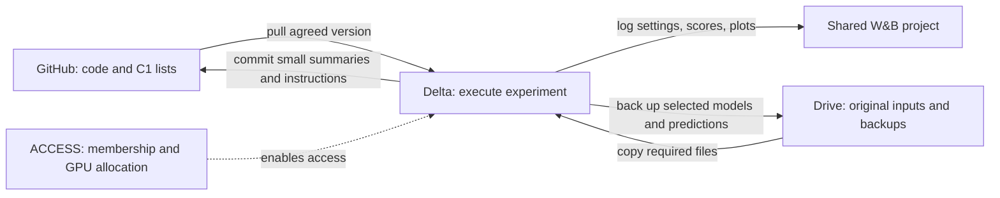

# Team workflow, decisions, and work ownership

**Recorded November 4, 2026.** This is the starting point for post-midterm work.
It records the confirmed C1 decision and TA work split, then makes the working
plan and pending handoffs explicit. Coding agents should also read [AGENTS.md](AGENTS.md).

**November 10 status update:** Nicole's tested C1 integration, real-input
audit, three-stage 16-event smoke checkpoint, and paired eight-test-event
controls are in [PR #4](https://github.com/DaezeI/11785-GS-Fuse-Submission-Public/pull/4),
open for review. See the [current technical handoff](analysis/text_value/C1_PROTOCOL.md),
[smoke results](analysis/text_value/C1_SMOKE_RESULTS.md), and
[dated team update](docs/updates/2026-11-10-c1-implementation.md). The smoke
checkpoint is not a full C1 baseline. The historical state recorded below is
identified where it predates this update.

## 1. Agreed decisions and actual status

| Item | Status | What this means |
|---|---|---|
| Main data split | **Confirmed: C1.** Nicole communicated the team agreement in the group chat. | Main experiments going forward use the committed C1 lists. |
| C2 | Optional additional historical stress test; no required run agreed. | Finish the common C1 setup first. C2 needs separate training and validation. |
| C3 | Outside the immediate plan. | Preserve its existing manifest; no new C3 experiment is required by this agreement. |
| Work ownership | The TA-meeting split in Section 4. | Four diagnostic streams, with shared dependencies below. |
| Nicole's initial contribution | [PR 1](https://github.com/DaezeI/11785-GS-Fuse-Submission-Public/pull/1) merged into `main`. | The audit, analysis, inference tools, tests, and results are available to everyone. |
| C1 training integration | **Implemented and tested in open PR #4; pending review/merge.** | Normal training, smoke training, and paired evaluation now use the same opt-in C1 loader. Pull the PR branch to inspect before merge. |
| Nicole's full-model text-control evaluation | **Eight-event smoke completed on a new 16-training-event checkpoint.** | Correct, three shuffled seeds, and two separate article-free modes ran; these are execution checks, not a C1 benchmark. |
| Jessica's text padding-mask fix | **Merged to `main` in commit `96cc6d7` on November 9.** | Her change propagates the tokenizer padding mask and adds three CPU unit tests. Her PR says full-model validation was not yet run; ask her to link any relevant Q-Former analysis missing from GitHub before assigning more work. |
| Shared GPU resource | **NCSA Delta GPU** allocation confirmed in the team portal. | Joye coordinates the working setup; it is not confirmed ready by this document. |
| Individual Delta access | **Nicole's noninteractive SSH access verified November 10.** Other users' login readiness is unverified here. | Each teammate still verifies their own access. |
| Delta paths, environment, launch example | **Nicole verified shared inputs/environment and completed two separate Slurm jobs.** Joye's common setup handoff remains separately owned. | Exact commands, job IDs, and output locations are in PR #4; do not infer that every teammate's setup is ready. |

**Adopting C1 addresses the known split-design problem. It does not verify every
possible source of leakage.** Publication times, preprocessing, training-stage
boundaries, auxiliary report sampling, and checkpoint history still need checks.

## 2. How the services connect

| Service | Use it for |
|---|---|
| GitHub | Code, split lists, tests, instructions, this decision record, and small result summaries. |
| Google Drive | Original articles/prices, team documents, existing model files, and backups of selected important outputs. |
| NCSA Delta | GPU execution and working copies of data, backbones, caches, checkpoints, and predictions. |
| Weights & Biases (W&B) | Experiment configurations, progress, scores, and charts. Model/prediction files exist there only if explicitly uploaded. |
| ACCESS | Allocation balance, project membership, and resource-account administration for Delta. |



These services do not automatically synchronize. W&B membership does not grant
Delta access. Pulling GitHub does not download articles or weights. Drive files
must be transferred to Delta before a job can read them there.

Use common, versioned data/model locations on Delta, but a separate code checkout
and output directory for each person or experiment. Do not overwrite another
person's checkout or saved outputs. Delta provides shared project/work storage;
GPU work goes through its scheduler. Follow the official
[login](https://docs.ncsa.illinois.edu/systems/delta/en/latest/user_guide/login.html),
[storage](https://docs.ncsa.illinois.edu/systems/delta/en/latest/user_guide/data_mgmt.html),
and [job](https://docs.ncsa.illinois.edu/systems/delta/en/latest/user_guide/running_jobs.html)
guides. Important outputs also need a backup; Delta is not the sole archive.

## 3. The C1 protocol and remaining code gap

Canonical list: [purged_split_c1_macro_eras.json](splits/manifests/purged_split_c1_macro_eras.json).
The timeline has five consecutive blocks: three training, one validation, one
test, with boundary events removed.

| Role | Actual retained event dates | Event entries |
|---|---|---:|
| Training | 2008-01-10 to 2017-10-04 | 6,167 |
| Validation | 2017-10-11 to 2021-01-05 | 2,500 |
| Test | 2021-01-12 to 2024-04-05 | 2,921 |

These are article/event counts, not independent price-window counts. Reports
can share price windows within one partition; dependence still matters for
uncertainty estimates.

Nicole checked actual 35-input-plus-140-target bar intervals for all three
proposed manifests. There were no cross-partition shared bars under either
tested timing policy. The original price file also contained 162 exact duplicate
rows from two repeated sessions; a separate sorted, deduplicated copy was made.
The original was preserved. See [the audit summary](analysis/text_value/data_audit_summary.json).

What this does not establish:

- Actual article release times, the CSV timezone, and whether timestamps mark
  bar starts or ends remain unverified.
- The two tested policies are `legacy_all0830_floor` and
  `category4_1400_strict_before`. The second is a sensitivity check, not a
  verified historical release-time table. Do not assume all releases were at
  08:30 or all historical category-4 announcements were at 14:00.
- Rerun the window audit on the exact emitted windows after changing timing,
  filtering, or price cleanup. Unknown release times stay documented as unknown.

At the November 4 code baseline, before PR #4:

- [train.py](train.py) still constructs the original `event_set` and a separate
  Stage-1 `sliding_window_set`. It has no C1 manifest option.
- [data/purged_dataloader.py](data/purged_dataloader.py) has a dataset class and
  manifest builder. The `build_purged_dataloaders` factory shown in older notes
  is not defined there.
- [run_text_controls.py](scripts/run_text_controls.py) uses the original event
  loader. It is an existing-checkpoint diagnostic, not yet a C1 evaluator.
- DLinear uses its own continuous-window protocol. Old DLinear scores cannot
  be directly ranked against event-test scores with different samples/scaling.

**A C1 filename, run name, or metadata label is not proof of C1 training.** Verify
actual samples and preprocessing in every training and evaluation stage.

## 4. Who does what

The four diagnostic streams below are the TA-meeting split. Joye additionally
coordinates common computing setup. The acceptance criteria make pending work
concrete; they do not claim it is already completed.

### Nicole: data integration, then text usefulness

Already completed: independent split/price checks; simple CPU price references;
reproducible analysis of Adaeze's aggregate results; an article-free inference
helper, paired runner/analyzer, and a published record of 25 focused passing tests.
See [the existing handoff](analysis/text_value/README.md).

**Completed in PR #4: shared C1 loading for training and evaluation.** The
requirements below are the implementation/review checklist; the executed
audit and tests are in the [technical handoff](analysis/text_value/C1_PROTOCOL.md).

1. Consume the committed manifest rather than redesigning Adaeze's split.
   Normalize Windows-style paths and preserve stable event IDs.
2. Verify listed articles and price windows exist. Report missing inputs rather
   than silently dropping examples. Save excluded IDs/counts for any necessary,
   documented filtering.
3. Enforce boundaries in **all three training stages**. In particular, Stage-1
   price sliding windows must not train on validation/test periods or cross
   partition boundaries. Stages 2/3 use the intended C1 event lists.
4. Fit scalers, learned preprocessing, and analysis thresholds on training data
   only; save and reuse the transformations for validation/test.
5. Check training negative-report pools and auxiliary inputs for validation/test
   contamination. Precomputed frozen features do not justify fitting on held-out data.
6. Record the exact price version and timing policy. Audit actual loader-emitted
   windows, then add CPU checks for membership, boundaries, scaling, path handling,
   and missing inputs. Preserve the model's expected batch structure.
7. Connect evaluation to the same C1 IDs/scaler. PR #4 now supplies this opt-in
   path; use its explicit manifest and timing flags and verify checkpoint history.

**Then evaluate text:** keep checkpoint and price examples fixed; compare correct
articles, several seeded shuffled assignments, and explicit no-text. Save paired
predictions, targets, event IDs/dates/types, donor IDs, and past prices/volatility.
Analyze event types, past-only volatility, and horizons 35/70/140, accounting for
shared dates and overlapping forecasts when estimating uncertainty. Use saved
per-example predictions if available to avoid unnecessary GPU inference.

The loader, small end-to-end job, paired outputs, and reproducible summary now
exist in PR #4. Next: resolve per-event article timing and the price CSV
timezone/bar-label convention, then run paired controls on a separately
trained **full C1 baseline**. The smoke checkpoint cannot fill that role.

### Adaeze: original gate

Question: why does the gate stay near one half, and does learning its variation
actually improve forecasts?

- Plot supervision targets, measured per-event text benefit, and learned weights.
  Define exactly how text benefit is calculated.
- Compare learned and constant gates under matched data/configuration/metrics.
  Choose any tuned constant on validation, not test.
- Check gradients in intended trainable components. Llama is normally frozen;
  missing gradients there alone do not establish training failure.
- Test whether inputs predict when text helps. Treat weak signal, supervision
  construction, and optimization as distinct candidate explanations.
- Coordinate with Nicole on control definitions. The built-in TS-only path uses
  text-conditioned price features. Nicole's new **inference helper does not fix
  training supervision**; a training change needs separate gradient/runtime checks.

Done means scripts, distributions, matched control results, and an evidence-backed
explanation or clearly bounded unresolved cause.

### Joye: MoE and common Delta setup

MoE question: are experts distinct, and does routing improve predictions?

- Save routing probabilities by event type and expert utilization.
- Compare individual expert outputs before aggregation.
- Compare normal routing with fixed and forced-expert controls. Record whether
  each is inference-only or separately trained and what is held fixed.
- Distinguish routing, specialization, and shared-supervision problems before
  making a targeted change.

MoE done means reproducible routing/expert diagnostics, matched controls, and
support for the proposed improvement.

**Delta setup handoff:**

1. Verify each teammate's individual login, then identify shared non-secret
   data/model/output locations and actual available file versions.
2. Locate the reference baseline checkpoint and complete input files. Existing
   old-machine paths are not proof the files exist on Delta.
3. Record a tested environment and a small working GPU job in GitHub.
   [environment.yml](environment.yml) is a starting point, not proof of a tested
   Delta installation. Record resolved dependencies rather than assuming old
   README installation commands match the working run.
4. Demonstrate a small job that loads the model/data, saves outputs, and records
   a shared W&B run. Synchronize offline W&B logs if online logging is unavailable.
5. After Nicole's integration and data/time checks, coordinate **one common C1
   baseline**. Other owners use the agreed protocol/reference rather than each
   independently reproducing a different baseline.

Joye need not execute every teammate's job. Once the example works, each owner
can run their own experiments with their own checkout/output directories.

### Jessica: Q-Former

Question: are queries complementary, and is padding interfering with attention?

Jessica's padding-mask implementation and three CPU tests are already merged
into `main` (commit `96cc6d7`). The following are **follow-up research checks**,
not a request to implement that fix again. Her PR reported no full-model run;
ask her to link any relevant analysis that is missing from GitHub.

- Measure attention mass on padding; verify actual mask semantics and
  variable-length/all-padding handling where relevant.
- Measure similarity of query attention patterns and output representations
  separately.
- Test padding-mask correction and query ablations as separate controlled changes.
- Measure forecast effects under the common protocol. A visualization or similar
  queries alone do not establish that useful predictive information was lost.

Done means attention/query diagnostics, targeted tested code, and matched forecast
results once compute and common inputs are available.

## 5. Dependencies and parallel work

| Checkpoint | Owner | Evidence it is finished | Enables |
|---|---|---|---|
| A. Delta inputs and example | Joye; file owners supply existing assets | Login works; shared inputs verified; small job finishes; W&B/output links recorded | Everyone can execute jobs. |
| B. C1 data integration | Nicole; Adaeze supplies exact existing split/filter code if needed | **Completed in open PR #4:** loader checks and emitted-window audit pass; timing assumptions recorded | Review/merge and plan corrected full training after timing decision. |
| C. Shared C1 baseline | Joye coordinates; Nicole verifies data side | Recorded configuration, training history, checkpoint, predictions, metrics, and run link | Common reference and final C1 text controls. |
| D. Per-stream diagnosis | Each owner above | Diagnostic scripts/results and controlled comparisons | Supported improvements and final-report conclusions. |

A and B originally proceeded in parallel; Nicole's B is now implemented in
open PR #4. Everyone can inspect code and write small tests now.
Historical checkpoints/logs support exploratory diagnosis while the common full
C1 baseline is pending;
label those results with their historical protocol. Final corrected performance
comparisons depend on B and C. Gate/MoE/Q-Former inspection does not need to wait
for Nicole's complete text analysis.

**Code overlap:** Nicole will touch shared data/training/evaluation interfaces.
Adaeze, Joye, and Jessica may all touch `model/gs_fuse.py` or `model/variants.py`.
Coordinate edits to common functions, use focused branches/PRs, and avoid broad
formatting or unrelated architecture changes inside a shared setup change.

## 6. Reference run identities and pending files

### Joye's midterm baseline: initial diagnostic reference

- [Shared W&B project](https://forge.coreweave.com/wandb/zhaohan2-carnegie-mellon-university/11785-GS-Fuse)
  and [baseline overview](https://forge.coreweave.com/wandb/zhaohan2-carnegie-mellon-university/11785-GS-Fuse/runs/2c5m4xe2/overview).
- Recorded October 23, 2026; Finished, tag `full`; Stage-1/2/3 epoch summaries present.
- Llama-3.2-1B, MOMENT-1-large, input 35, forecast 140, batch 8.
- Historical output directory: `outputs/full/baseline`; **not a verified new Delta path**.
- Inspected W&B listings contain settings/logs/requirements/metadata/summary and
  history/events artifacts. A matching downloadable model checkpoint was not
  found in those listings.
- **Pending:** matching `best_model.pth`, complete inputs, code version, and exact
  precision/cache settings. Do not assume Adaeze's configuration applies here.
- This run predates C1 adoption. It is not evidence of corrected C1 training.

### Adaeze's uploaded controls: a separate experiment

- [Scores](task2_shuffled_text/outputs/task2_shuffled_text_control.json) and
  [notes](task2_shuffled_text/TASK2_SHUFFLED_TEXT_LOGIC.md).
- Reported: Llama-3.2-3B in 4-bit, MOMENT-1-large, input 35, forecast 140,
  train/evaluation batches 8/16, Stage-1 stride 10.
- **Pending verification:** exact script, checkpoint, split/filter rules,
  zero-text implementation, and individual predictions if saved.
- Model size/quantization and training completeness are different issues. Do not
  infer which stages ran from the term "full" or the backbone size.
- Nicole's aggregate calculations describe this experiment, **not Joye's run**.
  A small shuffle gap alone does not prove text is useless or establish a cause.
- Raw-discovery and filtered evaluation populations differ; reproduce filtering
  before treating different audit/control event counts as an error.

### New C1 baseline

**Full baseline pending.** PR #4 contains a completed 16-training-event
three-stage smoke checkpoint and eight-event paired inference, not a full
baseline. See [the actual results](analysis/text_value/C1_SMOKE_RESULTS.md).
No completed full GS-Fuse C1 training run is established here.
Use fresh output directories: current training can automatically resume Stage-1/2
checkpoints found there. Older checkpoints may have seen C1 validation/test data.
Reuse stages only after verifying both training provenance and architecture
compatibility. Existing CPU C1 reference scores are not full GS-Fuse results.

## 7. What every experiment handoff should contain

Save small results/instructions in GitHub; large files in agreed shared storage,
with selected important outputs backed up. Copy this record into a result note:

```text
Owner / research question:
Status: planned | smoke-tested | running | completed | blocked
Purpose: historical diagnosis | corrected C1 benchmark | optional C2 stress test
Git commit / branch:
Exact command and configuration:
Environment and dependency record:
W&B run link:
Data/article versions or hashes:
Split manifest/hash; emitted train/validation/test counts:
Timing policy, timezone/bar meaning, unresolved publication-time assumptions:
Scaler/preprocessing fit population:
Checkpoint path/hash and training-stage/data history:
Backbones, precision/quantization, TF32 and cache signature:
Seeds, batch sizes, input/horizon, training budget:
Control definition; difference from the agreed baseline:
Prediction path; IDs/dates/types; array layout and targets:
Metric definitions, normalization, channel and horizons:
Checks actually run; results; checks/runs still pending:
Finding, limitations, next action, and handoff recipient:
```

Use separate output directories and descriptive W&B names by owner, split,
variant, seed, and intervention. A name such as `nicole-c1-text-controls` is only
a suggested convention, not an existing run or proof of data provenance.
Keep unavailable facts **PENDING**; update this document as paths/setup are verified.
Never commit credentials, private account records, raw articles/prices, or large
weights. Maintain original data and avoid overwriting another run's outputs.

## 8. Commands that exist now

When starting work, inspect your local Git status and preserve uncommitted work,
then update from the shared `main` through the normal Git workflow. Read this
document and `AGENTS.md`, identify your owner's stream, and create a focused
branch for the next change. If you are continuing an existing branch, incorporate
current main without overwriting anyone's work. No account or GPU setup is
needed merely to read these instructions or run the available CPU analysis.

CPU checks and aggregate reproduction, from the repository root:

```sh
python scripts/check_text_value.py
python scripts/summarize_text_controls.py
```

With PyTorch installed, require the tensor checks too:

```sh
python scripts/check_text_value.py --require-torch
```

Executed locally: **13/13 gate and C1 tests passed; 25/25 focused text-value
regression checks passed with no skips.** Python compilation and runner
`--help` also passed. CPU environment: Python 3.12.10, torch 2.15.0+cpu,
NumPy 2.5.4, pytest 9.2.0, pandas 3.1.1, scikit-learn 1.9.1. Delta's documented
torch 2.8/CUDA/backbone environment is different and has not been exercised
for this new runner. Slurm template has not been executed or submitted.

Without PyTorch, four helper checks are explicitly skipped. The published
[validation record](analysis/text_value/VALIDATION.md) documents 25 passing focused
tests with no skips in the tested CPU environment, not a full backbone/Delta test.
The private price CSV is also needed for `python scripts/audit_shared_splits.py`.

Inspect historical-checkpoint diagnostic options with:

```sh
python scripts/run_text_controls.py --help
```

Full execution needs CUDA, complete inputs, matching checkpoint/backbones and
precision/cache settings. Its default is 64 smoke events and 4-bit text loading.
The original protocol remains the default; C1 requires `--c1-manifest` and an
explicit `--c1-timing-policy`. The validated smoke batch scripts are
[`nicole_c1_smoke.sbatch`](scripts/delta/nicole_c1_smoke.sbatch) and
[`nicole_c1_paired_smoke.sbatch`](scripts/delta/nicole_c1_paired_smoke.sbatch).
The [text-value handoff](analysis/text_value/README.md) describes the
two no-text interventions: keep normal-fusion zero-token and fusion-bypass results
separate, and distinguish both from a separately trained price-only model.

## 9. Immediate next actions: agent handoff for Wednesday, November 11

### Start here, regardless of owner

1. Read [PR #4](https://github.com/DaezeI/11785-GS-Fuse-Submission-Public/pull/4),
   the [C1 protocol](analysis/text_value/C1_PROTOCOL.md), and the
   [smoke result](analysis/text_value/C1_SMOKE_RESULTS.md). PR #4 is open as
   of November 10; its branch is `nicole/c1-protocol-controls`. `main` does
   not contain these changes until the PR merges. In a fresh checkout, fetch
   the branch and create **your own** work branch from it if you need C1 code.
   Preserve any existing local edits or separate branches.

   ```sh
   git fetch origin
   git switch -c YOUR_TASK_BRANCH origin/nicole/c1-protocol-controls
   ```
2. Treat the 16-training-event checkpoint and eight-test-event comparison as
   an execution check. They cannot establish model performance or text value.
   The full NPZ files and checkpoint remain on Delta; the PR contains safe
   derived results. Do not compare its MSE to Adaeze's or Joye's historical
   scores as if they shared a checkpoint, scaler, or evaluation population.
3. By the Wednesday meeting, each owner should bring a link to an existing
   artifact or a concrete experiment plan, the input/checkpoint it needs, and
   one blocker or decision. A completed new GPU experiment is **not** required
   for this meeting. Put substantive code/results in a focused PR and record
   provenance with the [handoff fields in Section 7](#7-what-every-experiment-handoff-should-contain).
4. Check the submitted command and emitted split before calling a run "C1."
   The team jobs inspected on November 11 still used the earlier loader. The
   new full C1 timing-sensitivity training and paired jobs are identified in
   [their run plan](analysis/text_value/C1_FULL_SENSITIVITY_PLAN.md).

### Shared timing decision — team and TA, coordinated by Nicole

**Question:** Was each article publicly available before the price window it
is paired with? The manifest has 12 category folders and dates, but no
publication timestamps. Categories 7–12 contain most C1 entries. The smoke
run explicitly assumed `category4_1400_strict_before`; the price CSV timezone
and whether a timestamp labels the bar start or end are unverified.

**Do next:** assign one owner to locate the dataset's source/time definitions
and a release-time source for each event type, including 7–12. Document the
category mapping from the team's actual Delta files; do not copy the upstream
six-category numbering without checking it. Determine the price CSV timezone
and bar-label convention from its source or an independently checkable sample.
Record which events have verified times and which remain unknown. If a new
timing rule is chosen, rerun the emitted-window audit and record exclusions,
overlap, and input hashes.

**Bring Wednesday:** a named owner, source links/files, a proposed policy for
unknown times, and a decision on whether a full C1 run can start. An explicit
"still unknown" decision is acceptable; do not silently treat 08:30 as fact.

### Joye — common C1 baseline and MoE

**Baseline now:** inspect the [C1 smoke job script](scripts/delta/nicole_c1_smoke.sbatch)
and handoff for the verified environment, paths, account, and command. The
smoke checkpoint is in Nicole's separate output directory and is **not** the
common baseline. Check whether any earlier *completed* GS-Fuse checkpoint has
matching code/data history before reusing it; pretrained Llama/MOMENT weights
alone are not a trained GS-Fuse checkpoint.

**Prepare now; submit after the timing decision:** specify one fresh full C1
training run:
code commit, manifest/price hashes, release-time policy, architecture and
backbones, all three stage settings, training-only scaler, seed, Slurm resource
request, estimated GPU cost, output directory, and W&B logging. Use a fresh
output directory so old Stage-1/2 checkpoints cannot resume silently. Record
the finished checkpoint hash and training history before other streams use it.

**MoE in parallel:** on an identified checkpoint, save per-event router
probabilities, expert utilization, and pre-aggregation expert outputs; compare
normal routing with fixed/forced-expert controls on the same examples. Label
historical-checkpoint results as historical. Bring Wednesday a baseline plan,
any located checkpoint provenance, and the first MoE artifact or exact missing
input. Publish the eventual run record/diagnostics in Joye's own PR.

### Adaeze — original gate

**Start:** identify the code and checkpoint that produced the current gate
plots/scores. Read [Nicole's text-control explanation](analysis/text_value/README.md#a-code-issue-identified-during-review):
the built-in named TS-only comparison can contain article-conditioned price
features; Nicole's clean no-text helper is **inference-only** and does not
replace a differentiable training target.

**Checkpoint for this task:** no completed full C1 checkpoint has been verified
yet. The 16-event C1 smoke checkpoint at
`/work/hdd/bjjg/gs-fuse/nicole/c1-nov10/smoke/run1/best_model.pth` is suitable
only for debugging gate instrumentation, not a reportable comparison. Full C1
timing-sensitivity training is queued as Slurm job `23812725`; if it finishes,
its checkpoint will be
`/work/hdd/bjjg/gs-fuse/nicole/c1-nov11/full_sensitivity_v1/best_model.pth`.
Check its [run plan and provenance](analysis/text_value/C1_FULL_SENSITIVITY_PLAN.md)
before using it. For matched gate results, use this same cross-attention
checkpoint and C1 examples for learned/constant controls; choose constants on
validation and evaluate on test. Historical split checkpoints can support
separate exploratory diagnosis but must be labelled with their own protocol.

**Diagnose:** save distributions of gate supervision targets, learned gate
weights, and per-event text benefit with the exact benefit formula. Check
gradients in intended trainable gate/fusion components. Compare the learned
gate with constants chosen on validation, then evaluated on the *same* test
examples and metric. Keep architecture/checkpoint differences explicit; if a
gate-training change is proposed, test its gradient/runtime path separately.

**Bring Wednesday:** the current artifact/code link, the gate-target formula,
and the first plot or a precise missing checkpoint/input. Publish matched
controls and a bounded explanation in Adaeze's own PR when ready.

### Jessica — Q-Former

**Already done:** Jessica's padding-mask fix and three CPU tests landed in
`main` through merge commit `96cc6d7`. Do not ask her to redo that work.
Her [padding-fix PR](https://github.com/DaezeI/11785-GS-Fuse-Submission-Public/pull/2)
explicitly reported that the fix had not yet been run on the full model at
that time. No post-fix full-model analysis is linked in the repository as of
this review. Ask her to link any relevant Q-Former results missing from GitHub;
if there are none, decide together whether further analysis is useful.

**If she wants to continue Q-Former diagnosis:** run a small real cached-text
batch using the fixed code and record the fraction of tokens marked PAD and
the measured attention mass on PAD. The current CPU tests use a fake tokenizer
and do not exercise the disk-cache path. On a cache length mismatch,
`encode_tokens` currently falls back to the saved mask, which may be the old
all-False mask; verify or repair this before interpreting a cached run.

**Then, if still open:** measure query-attention similarity and query-output
similarity separately after masking. A later query ablation should compare
matching examples/checkpoints; measure forecast effects after the common C1
baseline exists. Label historical-checkpoint analyses as exploratory.

**Bring Wednesday:** the merged-fix link and links to any Q-Former results
missing from GitHub, if there are any. Then decide whether she wants to own
the remaining Q-Former analysis or pick up another team need. No new Q-Former
GPU result is required for this meeting.

### Nicole — C1/text comparison and integration

Review comments on PR #4, keep the audit/manifest hashes and explicit timing
policy in any revised run, and coordinate the timing decision above. After
Joye supplies a provenance-checked full C1 checkpoint, run the paired controls
on the same C1 test events with correct text, multiple seeded shuffles, and
both separately named no-text interventions. Analyze horizons 35/70/140 and
uncertainty by distinct event dates; publish small derived results and exact
commands, leaving raw articles/prices and weights off GitHub. Bring Wednesday
the PR link, smoke limitation, and timing questions; do not present the smoke
MSE as the team's final score.

## Adaeze: C1 gate-analysis preparation (November 11)

**User direction:** take recovery of the historical midterm checkpoint off the
critical path. Use Nicole's completed full C1 sensitivity checkpoint when
available. Historical W&B observations remain a separate record. Do not use
Adaeze's laptop checkpoint for new runs.

**Status: code prepared locally; CPU checks executed; full-backbone/GPU smoke
and all new experimental results PENDING.** No Delta job has been submitted
by this preparation. This branch is based on Nicole's published C1 integration
at `2d868326`; it does not replace her staged checkout or loader.

### The first question and actual changes

Compare the learned softmax gate with a pre-specified 50/50 gate on exactly the
same checkpoint, event IDs, targets, and aligned features. This is an
inference intervention, not a separately trained constant-gate model.
The constant is fixed in advance; there is no search over test results.

- `model/gate_analysis.py`: obtain actual per-channel gates and predictions;
  keep encoded/aligned features fixed while replacing only the fusion weights.
  Reconstruct the current supervision formula using the original,
  text-conditioned TS reference. Record it as a diagnostic, not clean causal
  text benefit or a recovered historical training target.
- `scripts/run_gate_analysis.py`: consume Nicole's shared C1 loader, verify
  manifest/price/scaler/counts against the training audit, check architecture
  and saved module states, require a completed training log, and write paired
  predictions plus configuration/source/checkpoint hashes. It compares the
  first learned-prediction batch with the standard prediction entrypoint.
- `scripts/analyze_gate_analysis.py`: derive MSE at 35/70/140, event-level
  gate statistics, and observed gate/zero-token-benefit correlation from saved
  arrays. No simulated observations or hard-coded performance numbers.
- `configs/adaeze_gate_c1.json`: known planned checkpoint and shared input paths.
  Existence/read access to the finished checkpoint is still PENDING.
- `scripts/delta/adaeze_gate_analysis.sbatch`: one template with `smoke` and
  `full` phases, a unique job output directory, and no training/optimizer step.
- `tests/test_gate_analysis.py`: actual replacement semantics, unchanged model
  parameters, gradient-state restoration, invalid values, audit mismatch, and
  saved-prediction analysis checks on tiny CPU fixtures.

The optional gradient probe uses the first C1 **training** batch, in evaluation
mode with detached encoded features. It reports gate-parameter derivatives for
forecast MSE and gate-supervision MSE separately. It is not the complete
training objective, does not reproduce past training batches/dropout, and does
not establish the cause of gate behavior. No optimizer is constructed.

A zero fusion text weight would still leave text-conditioned aligned price
features. This preparation therefore keeps Nicole's `zeroed_article_tokens`
control separately named, and does not call the fixed-gate intervention
"price-only." Her full paired shuffled/bypass jobs remain separate.

### Local checks and Delta handoff

Use a dedicated checkout in Antigravity; do not edit the inspection copy or
Nicole's live Delta checkout. The test environment is CPU-only and does not
contain the pretrained backbones. It is not a replacement for Delta's model
environment. On a Python environment with torch/numpy/pandas/scikit-learn/pytest:

```bash
python -m pytest tests/test_gate_analysis.py tests/test_c1_protocol.py -q
python scripts/check_text_value.py --require-torch
```

After this code is reviewed and transferred to **Adaeze's own** Delta checkout,
activate the already documented shared environment and set its actual location
and a new output root in a directory you own. Do not paste placeholder paths
without replacing them:

```bash
export REPO_DIR=/replace/with/adaezes/actual/checkout
export OUT_ROOT=/replace/with/adaezes/new/gate-output-directory
export PHASE=smoke
sbatch --export=ALL scripts/delta/adaeze_gate_analysis.sbatch
```

The smoke phase evaluates 16 validation events and includes one training-batch
gradient probe. Inspect `run_record.json`, `gradient_probe.json`, and the
analysis summary. This verifies execution, not forecast quality. Check that
the learned prediction matches the standard entrypoint and that all gates and
predictions are finite. Only after it passes, submit the same template with
`PHASE=full` for all validation and test events, using the same pre-specified
50/50 constant. Each job uses a new job-ID directory and refuses to overwrite
existing prediction/analysis outputs. Failed/preempted analyses do not resume;
resubmit into a new job directory.

The template requests one preemptible A100 for up to eight hours, matching the
known partition/environment conventions; this is a requested cap, not a
measured runtime guarantee. No automatic submission/dependency is configured.

Full prediction NPZ files include targets and stay on Delta. Small derived
summaries may be shared after review; do not upload raw articles, prices,
checkpoint weights, token caches, or credentials. The analyzer currently
produces descriptive metrics and CSVs, without significance claims or
confidence intervals. Plotting and date-block uncertainty analysis are later
extensions, not completed deliverables.

### Interpretation and outstanding inputs

The old local gate-plot script mixes actual gate observations with simulated
benefit samples and hard-coded benchmark/correlation values. Those outputs
must not be treated as measured constant-gate evidence or gradient diagnoses.
They are preserved; this branch supplies a separate measured workflow.

Pending before reporting a new result: completed C1 checkpoint and matching
audit/log; verified read permissions; actual deployed code/version; successful
small GPU job; full paired outputs; environment record; analysis interpretation;
W&B link if subsequently logged (this runner does not log a new W&B run).
The current C1 release-time and price timezone/bar-label limitations still
apply. A small gate spread or a close 50/50 comparison alone proves no cause.
