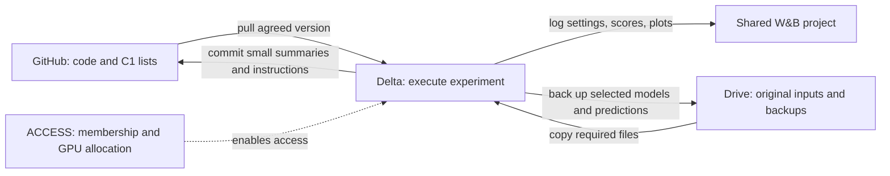

# Team workflow, decisions, and work ownership

**Recorded November 4, 2026.** This is the starting point for post-midterm work.
It records the confirmed C1 decision and TA work split, then makes the working
plan and pending handoffs explicit. Coding agents should also read [AGENTS.md](AGENTS.md).

## 1. Agreed decisions and actual status

| Item | Status | What this means |
|---|---|---|
| Main data split | **Confirmed: C1.** Nicole communicated the team agreement in the group chat. | Main experiments going forward use the committed C1 lists. |
| C2 | Optional additional historical stress test; no required run agreed. | Finish the common C1 setup first. C2 needs separate training and validation. |
| C3 | Outside the immediate plan. | Preserve its existing manifest; no new C3 experiment is required by this agreement. |
| Work ownership | The TA-meeting split in Section 4. | Four diagnostic streams, with shared dependencies below. |
| Nicole's initial contribution | [PR 1](https://github.com/DaezeI/11785-GS-Fuse-Submission-Public/pull/1) merged into `main`. | The audit, analysis, inference tools, tests, and results are available to everyone. |
| C1 training integration | **Pending in inspected main, commit `47bb1da29046d8781fec1d4f6284b83f257e4397`.** | A split JSON is not yet connected to training or the paired evaluation runner. |
| Nicole's full-model text-control evaluation | **Not run.** | Small helper tests and aggregate calculations are not a full checkpoint evaluation. |
| Shared GPU resource | **NCSA Delta GPU** allocation confirmed in the team portal. | Joye coordinates the working setup; it is not confirmed ready by this document. |
| Individual Delta access | Nicole's resource username showed **Pending**. Other users' login readiness is unverified here. | Membership and an active allocation are not a successful login test. |
| Delta paths, environment, launch example | **Pending confirmation by Joye.** | Agents must not invent working paths, job-account names, or successful runs. |

**Adopting C1 addresses the known split-design problem. It does not verify every
possible source of leakage.** Publication times, preprocessing, training-stage
boundaries, auxiliary report sampling, and checkpoint history still need checks.

## 2. How the services connect

| Service | Use it for |
|---|---|
| GitHub | Code, split lists, tests, instructions, this decision record, and small result summaries. |
| Google Drive | Original articles/prices, team documents, existing model files, and backups of selected important outputs. |
| NCSA Delta | GPU execution and working copies of data, backbones, caches, checkpoints, and predictions. |
| Weights & Biases (W&B) | Experiment configurations, progress, scores, and charts. Model/prediction files exist there only if explicitly uploaded. |
| ACCESS | Allocation balance, project membership, and resource-account administration for Delta. |



These services do not automatically synchronize. W&B membership does not grant
Delta access. Pulling GitHub does not download articles or weights. Drive files
must be transferred to Delta before a job can read them there.

Use common, versioned data/model locations on Delta, but a separate code checkout
and output directory for each person or experiment. Do not overwrite another
person's checkout or saved outputs. Delta provides shared project/work storage;
GPU work goes through its scheduler. Follow the official
[login](https://docs.ncsa.illinois.edu/systems/delta/en/latest/user_guide/login.html),
[storage](https://docs.ncsa.illinois.edu/systems/delta/en/latest/user_guide/data_mgmt.html),
and [job](https://docs.ncsa.illinois.edu/systems/delta/en/latest/user_guide/running_jobs.html)
guides. Important outputs also need a backup; Delta is not the sole archive.

## 3. The C1 protocol and remaining code gap

Canonical list: [purged_split_c1_macro_eras.json](splits/manifests/purged_split_c1_macro_eras.json).
The timeline has five consecutive blocks: three training, one validation, one
test, with boundary events removed.

| Role | Actual retained event dates | Event entries |
|---|---|---:|
| Training | 2008-01-10 to 2017-10-04 | 6,167 |
| Validation | 2017-10-11 to 2021-01-05 | 2,500 |
| Test | 2021-01-12 to 2024-04-05 | 2,921 |

These are article/event counts, not independent price-window counts. Reports
can share price windows within one partition; dependence still matters for
uncertainty estimates.

Nicole checked actual 35-input-plus-140-target bar intervals for all three
proposed manifests. There were no cross-partition shared bars under either
tested timing policy. The original price file also contained 162 exact duplicate
rows from two repeated sessions; a separate sorted, deduplicated copy was made.
The original was preserved. See [the audit summary](analysis/text_value/data_audit_summary.json).

What this does not establish:

- Actual article release times, the CSV timezone, and whether timestamps mark
  bar starts or ends remain unverified.
- The two tested policies are `legacy_all0830_floor` and
  `category4_1400_strict_before`. The second is a sensitivity check, not a
  verified historical release-time table. Do not assume all releases were at
  08:30 or all historical category-4 announcements were at 14:00.
- Rerun the window audit on the exact emitted windows after changing timing,
  filtering, or price cleanup. Unknown release times stay documented as unknown.

At the recorded code baseline:

- [train.py](train.py) still constructs the original `event_set` and a separate
  Stage-1 `sliding_window_set`. It has no C1 manifest option.
- [data/purged_dataloader.py](data/purged_dataloader.py) has a dataset class and
  manifest builder. The `build_purged_dataloaders` factory shown in older notes
  is not defined there.
- [run_text_controls.py](scripts/run_text_controls.py) uses the original event
  loader. It is an existing-checkpoint diagnostic, not yet a C1 evaluator.
- DLinear uses its own continuous-window protocol. Old DLinear scores cannot
  be directly ranked against event-test scores with different samples/scaling.

**A C1 filename, run name, or metadata label is not proof of C1 training.** Verify
actual samples and preprocessing in every training and evaluation stage.

## 4. Who does what

The four diagnostic streams below are the TA-meeting split. Joye additionally
coordinates common computing setup. The acceptance criteria make pending work
concrete; they do not claim it is already completed.

### Nicole: data integration, then text usefulness

Already completed: independent split/price checks; simple CPU price references;
reproducible analysis of Adaeze's aggregate results; an article-free inference
helper, paired runner/analyzer, and a published record of 25 focused passing tests.
See [the existing handoff](analysis/text_value/README.md).

**Next deliverable: shared C1 loading for training and evaluation.**

1. Consume the committed manifest rather than redesigning Adaeze's split.
   Normalize Windows-style paths and preserve stable event IDs.
2. Verify listed articles and price windows exist. Report missing inputs rather
   than silently dropping examples. Save excluded IDs/counts for any necessary,
   documented filtering.
3. Enforce boundaries in **all three training stages**. In particular, Stage-1
   price sliding windows must not train on validation/test periods or cross
   partition boundaries. Stages 2/3 use the intended C1 event lists.
4. Fit scalers, learned preprocessing, and analysis thresholds on training data
   only; save and reuse the transformations for validation/test.
5. Check training negative-report pools and auxiliary inputs for validation/test
   contamination. Precomputed frozen features do not justify fitting on held-out data.
6. Record the exact price version and timing policy. Audit actual loader-emitted
   windows, then add CPU checks for membership, boundaries, scaling, path handling,
   and missing inputs. Preserve the model's expected batch structure.
7. Connect evaluation to the same C1 IDs/scaler. The current paired runner still
   needs this integration; do not invent an already-supported C1 command.

**Then evaluate text:** keep checkpoint and price examples fixed; compare correct
articles, several seeded shuffled assignments, and explicit no-text. Save paired
predictions, targets, event IDs/dates/types, donor IDs, and past prices/volatility.
Analyze event types, past-only volatility, and horizons 35/70/140, accounting for
shared dates and overlapping forecasts when estimating uncertainty. Use saved
per-example predictions if available to avoid unnecessary GPU inference.

Done means tested shared loading, a small end-to-end job with verified inputs,
and paired outputs plus a reproducible summary when full inference is available.

### Adaeze: original gate

Question: why does the gate stay near one half, and does learning its variation
actually improve forecasts?

- Plot supervision targets, measured per-event text benefit, and learned weights.
  Define exactly how text benefit is calculated.
- Compare learned and constant gates under matched data/configuration/metrics.
  Choose any tuned constant on validation, not test.
- Check gradients in intended trainable components. Llama is normally frozen;
  missing gradients there alone do not establish training failure.
- Test whether inputs predict when text helps. Treat weak signal, supervision
  construction, and optimization as distinct candidate explanations.
- Coordinate with Nicole on control definitions. The built-in TS-only path uses
  text-conditioned price features. Nicole's new **inference helper does not fix
  training supervision**; a training change needs separate gradient/runtime checks.

Done means scripts, distributions, matched control results, and an evidence-backed
explanation or clearly bounded unresolved cause.

### Joye: MoE and common Delta setup

MoE question: are experts distinct, and does routing improve predictions?

- Save routing probabilities by event type and expert utilization.
- Compare individual expert outputs before aggregation.
- Compare normal routing with fixed and forced-expert controls. Record whether
  each is inference-only or separately trained and what is held fixed.
- Distinguish routing, specialization, and shared-supervision problems before
  making a targeted change.

MoE done means reproducible routing/expert diagnostics, matched controls, and
support for the proposed improvement.

**Delta setup handoff:**

1. Verify each teammate's individual login, then identify shared non-secret
   data/model/output locations and actual available file versions.
2. Locate the reference baseline checkpoint and complete input files. Existing
   old-machine paths are not proof the files exist on Delta.
3. Record a tested environment and a small working GPU job in GitHub.
   [environment.yml](environment.yml) is a starting point, not proof of a tested
   Delta installation. Record resolved dependencies rather than assuming old
   README installation commands match the working run.
4. Demonstrate a small job that loads the model/data, saves outputs, and records
   a shared W&B run. Synchronize offline W&B logs if online logging is unavailable.
5. After Nicole's integration and data/time checks, coordinate **one common C1
   baseline**. Other owners use the agreed protocol/reference rather than each
   independently reproducing a different baseline.

Joye need not execute every teammate's job. Once the example works, each owner
can run their own experiments with their own checkout/output directories.

### Jessica: Q-Former

Question: are queries complementary, and is padding interfering with attention?

- Measure attention mass on padding; verify actual mask semantics and
  variable-length/all-padding handling where relevant.
- Measure similarity of query attention patterns and output representations
  separately.
- Test padding-mask correction and query ablations as separate controlled changes.
- Measure forecast effects under the common protocol. A visualization or similar
  queries alone do not establish that useful predictive information was lost.

Done means attention/query diagnostics, targeted tested code, and matched forecast
results once compute and common inputs are available.

## 5. Dependencies and parallel work

| Checkpoint | Owner | Evidence it is finished | Enables |
|---|---|---|---|
| A. Delta inputs and example | Joye; file owners supply existing assets | Login works; shared inputs verified; small job finishes; W&B/output links recorded | Everyone can execute jobs. |
| B. C1 data integration | Nicole; Adaeze supplies exact existing split/filter code if needed | Loader checks and emitted-window audit pass; timing assumptions recorded | Corrected training/evaluation. |
| C. Shared C1 baseline | Joye coordinates; Nicole verifies data side | Recorded configuration, training history, checkpoint, predictions, metrics, and run link | Common reference and final C1 text controls. |
| D. Per-stream diagnosis | Each owner above | Diagnostic scripts/results and controlled comparisons | Supported improvements and final-report conclusions. |

A and B proceed in parallel. Everyone can inspect code and write small tests now.
Historical checkpoints/logs support exploratory diagnosis while C1 is pending;
label those results with their historical protocol. Final corrected performance
comparisons depend on B and C. Gate/MoE/Q-Former inspection does not need to wait
for Nicole's complete text analysis.

**Code overlap:** Nicole will touch shared data/training/evaluation interfaces.
Adaeze, Joye, and Jessica may all touch `model/gs_fuse.py` or `model/variants.py`.
Coordinate edits to common functions, use focused branches/PRs, and avoid broad
formatting or unrelated architecture changes inside a shared setup change.

## 6. Reference run identities and pending files

### Joye's midterm baseline: initial diagnostic reference

- [Shared W&B project](https://forge.coreweave.com/wandb/zhaohan2-carnegie-mellon-university/11785-GS-Fuse)
  and [baseline overview](https://forge.coreweave.com/wandb/zhaohan2-carnegie-mellon-university/11785-GS-Fuse/runs/2c5m4xe2/overview).
- Recorded October 23, 2026; Finished, tag `full`; Stage-1/2/3 epoch summaries present.
- Llama-3.2-1B, MOMENT-1-large, input 35, forecast 140, batch 8.
- Historical output directory: `outputs/full/baseline`; **not a verified new Delta path**.
- Inspected W&B listings contain settings/logs/requirements/metadata/summary and
  history/events artifacts. A matching downloadable model checkpoint was not
  found in those listings.
- **Pending:** matching `best_model.pth`, complete inputs, code version, and exact
  precision/cache settings. Do not assume Adaeze's configuration applies here.
- This run predates C1 adoption. It is not evidence of corrected C1 training.

### Adaeze's uploaded controls: a separate experiment

- [Scores](task2_shuffled_text/outputs/task2_shuffled_text_control.json) and
  [notes](task2_shuffled_text/TASK2_SHUFFLED_TEXT_LOGIC.md).
- Reported: Llama-3.2-3B in 4-bit, MOMENT-1-large, input 35, forecast 140,
  train/evaluation batches 8/16, Stage-1 stride 10.
- **Pending verification:** exact script, checkpoint, split/filter rules,
  zero-text implementation, and individual predictions if saved.
- Model size/quantization and training completeness are different issues. Do not
  infer which stages ran from the term "full" or the backbone size.
- Nicole's aggregate calculations describe this experiment, **not Joye's run**.
  A small shuffle gap alone does not prove text is useless or establish a cause.
- Raw-discovery and filtered evaluation populations differ; reproduce filtering
  before treating different audit/control event counts as an error.

### New C1 baseline

**Pending.** No completed full GS-Fuse C1 training run is established here.
Use fresh output directories: current training can automatically resume Stage-1/2
checkpoints found there. Older checkpoints may have seen C1 validation/test data.
Reuse stages only after verifying both training provenance and architecture
compatibility. Existing CPU C1 reference scores are not full GS-Fuse results.

## 7. What every experiment handoff should contain

Save small results/instructions in GitHub; large files in agreed shared storage,
with selected important outputs backed up. Copy this record into a result note:

```text
Owner / research question:
Status: planned | smoke-tested | running | completed | blocked
Purpose: historical diagnosis | corrected C1 benchmark | optional C2 stress test
Git commit / branch:
Exact command and configuration:
Environment and dependency record:
W&B run link:
Data/article versions or hashes:
Split manifest/hash; emitted train/validation/test counts:
Timing policy, timezone/bar meaning, unresolved publication-time assumptions:
Scaler/preprocessing fit population:
Checkpoint path/hash and training-stage/data history:
Backbones, precision/quantization, TF32 and cache signature:
Seeds, batch sizes, input/horizon, training budget:
Control definition; difference from the agreed baseline:
Prediction path; IDs/dates/types; array layout and targets:
Metric definitions, normalization, channel and horizons:
Checks actually run; results; checks/runs still pending:
Finding, limitations, next action, and handoff recipient:
```

Use separate output directories and descriptive W&B names by owner, split,
variant, seed, and intervention. A name such as `nicole-c1-text-controls` is only
a suggested convention, not an existing run or proof of data provenance.
Keep unavailable facts **PENDING**; update this document as paths/setup are verified.
Never commit credentials, private account records, raw articles/prices, or large
weights. Maintain original data and avoid overwriting another run's outputs.

## 8. Commands that exist now

When starting work, inspect your local Git status and preserve uncommitted work,
then update from the shared `main` through the normal Git workflow. Read this
document and `AGENTS.md`, identify your owner's stream, and create a focused
branch for the next change. If you are continuing an existing branch, incorporate
current main without overwriting anyone's work. No account or GPU setup is
needed merely to read these instructions or run the available CPU analysis.

CPU checks and aggregate reproduction, from the repository root:

```sh
python scripts/check_text_value.py
python scripts/summarize_text_controls.py
```

With PyTorch installed, require the tensor checks too:

```sh
python scripts/check_text_value.py --require-torch
```

Without PyTorch, four helper checks are explicitly skipped. The published
[validation record](analysis/text_value/VALIDATION.md) documents 25 passing focused
tests with no skips in the tested CPU environment, not a full backbone/Delta test.
The private price CSV is also needed for `python scripts/audit_shared_splits.py`.

Inspect historical-checkpoint diagnostic options with:

```sh
python scripts/run_text_controls.py --help
```

Full execution needs CUDA, complete inputs, matching checkpoint/backbones and
precision/cache settings. Its default is 64 smoke events and 4-bit text loading.
Its loader is still the original protocol. **This document does not supply a
validated C1 launch command or Delta job script.** Add those after implementation
and testing. The [text-value handoff](analysis/text_value/README.md) describes the
two no-text interventions: keep normal-fusion zero-token and fusion-bypass results
separate, and distinguish both from a separately trained price-only model.

## 9. Immediate next actions

1. **Nicole:** implement/test C1 training and evaluation loading; continue release-
   time/source verification. Reuse the agreed manifest.
2. **Joye:** finish the small Delta example, verify shared input locations and
   the matching reference checkpoint, then record environment/job instructions.
3. **Adaeze:** point to existing control/audit scripts and predictions if available;
   continue gate diagnosis. Request repackaging only if complete files cannot
   otherwise be accessed.
4. **Jessica:** begin padding/query checks; label historical versus C1 outputs.
5. **All:** update handoff status and provenance as work lands. Pending access,
   publication-time checks, training integration, or GPU runs stay pending until
   verified; another agent must not infer completion from this plan.
