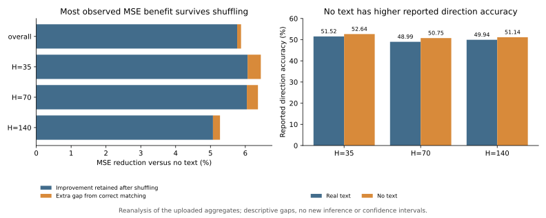
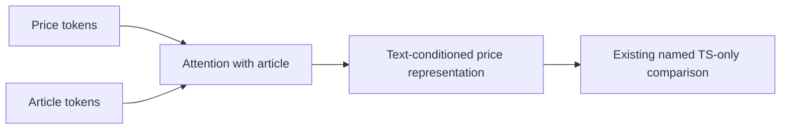

# Text value: code, results, and meeting handoff

**Question:** Does the correct event article improve forecasts beyond price inputs, and does the answer change with the forecasting horizon?

This is Nicole's analysis contribution, building on Adaeze's uploaded control experiment. Start with [the meeting brief](MEETING_BRIEF.md). The source experiment remains credited to Adaeze; the calculations, independent price audit, explicit no-text control, tests, and reproducible analysis tools are added here.

## Main finding from the existing results

Real text has 5.88% lower reported overall MSE than the uploaded no-text condition. **98.10% of that observed improvement remains when articles are shuffled.** Correct matching contributes the remaining 1.90% of the observed improvement. This is a descriptive decomposition of supplied metrics; it does not establish a causal mechanism or prove that semantics are useless.

| Reported metric | Real-text MSE reduction vs no text | Observed improvement retained with shuffled articles |
|---|---:|---:|
| Overall | 5.88% | 98.10% |
| H=35 | 6.45% | 94.11% |
| H=70 | 6.36% | 94.99% |
| H=140 | 5.27% | 96.17% |

Overall and horizon metrics are kept separate because their exact definitions are not verified. No confidence intervals are inferred from aggregate averages.



## A code issue identified during review

The existing built-in time-series-only comparison receives `analysis["s_vec_residual"]` after time-series tokens have attended to article tokens. That input therefore already contains text information. This occurs in both gate supervision and built-in modality scoring. See the reference implementation at [fusion](https://github.com/DaezeI/11785-GS-Fuse-Submission-Public/blob/02f2b742960384161a7ea0c79aacabb9eea43d9b/model/gs_fuse.py#L929), [gate target](https://github.com/DaezeI/11785-GS-Fuse-Submission-Public/blob/02f2b742960384161a7ea0c79aacabb9eea43d9b/model/gs_fuse.py#L1996), and [modality score](https://github.com/DaezeI/11785-GS-Fuse-Submission-Public/blob/02f2b742960384161a7ea0c79aacabb9eea43d9b/model/gs_fuse.py#L2435).



This establishes a dependency in the code, not its numerical effect. Adaeze's separate uploaded zero-text experiment may use a different path; its implementation has not been verified.

The new [no-text helper](../../model/no_text_control.py) creates fresh representations from price inputs only. It offers two explicitly different interventions:

- `zeroed_article_tokens`: one unmasked zero article token, with the normal fusion, gate, decoder, and refinement. Biases and price-to-text attention remain active; article content is absent.
- `fusion_bypass_ts_inst`: normalized clean time-series instance features sent directly to the same decoder/refinement. This additionally bypasses fusion and gating.

These are inference tools. Existing training losses and published scores are not changed by adding them.

## Run the completed aggregate analysis

From the repository root, using Python with NumPy and Matplotlib:

```sh
python scripts/summarize_text_controls.py
```

It reads the already committed `task2_shuffled_text/outputs/task2_shuffled_text_control.json` and regenerates the CSV, JSON, and chart here. It needs no model weights, GPU, raw financial data, or Drive login. [Open the CPU notebook in Colab](https://colab.research.google.com/github/DaezeI/11785-GS-Fuse-Submission-Public/blob/nicole/text-value-audit/analysis/text_value/Reproduce.ipynb).

The decomposition is:

```text
no-text error - real-text error
  = (no-text error - shuffled-text error)
  + (shuffled-text error - real-text error)
```

## Run a paired checkpoint diagnostic when inputs are available

Use the team's existing model environment and matching local checkpoint/backbones:

```sh
python scripts/run_text_controls.py \
  --model-path outputs/best_model.pth \
  --text-model-path pretrained/Llama-3.2-3B \
  --moment-path pretrained/MOMENT-1-large \
  --max-events 64 --shuffles 3 --batch-size 2 \
  --out outputs/text_controls.npz

python scripts/analyze_text_predictions.py \
  --predictions outputs/text_controls.npz \
  --out outputs/text_control_analysis.json
```

This defaults to an evenly spaced 64-event smoke sample on the **original** event-loader protocol for diagnosing an existing checkpoint. `--max-events 0` uses the full chosen split. It does not establish leakage-corrected C1 performance. Set `--checkpoint-training-split` only when known. Match architecture, backbone, precision, and checkpoint settings. `--no-text-mode fusion_bypass_ts_inst` selects the separate bypass intervention. `--shuffle-within-type` preserves event categories; donor IDs, same-date matches, and identical-content matches are recorded.

The output has paired predictions and common event IDs, prices, dates, types, training-only volatility reference, checkpoint/code hashes, and intervention definitions. The analyzer reports gains by type, past-only volatility, and horizon, with date-block bootstrap intervals when enough blocks exist. Intervals are conditional on the checkpoint and supplied shuffle draws.

**Full-backbone inference has not been run for this contribution.** The helper has been tested with real CPU PyTorch tensors and a small model fixture. New cohort/volatility performance claims await per-event predictions.

## Independently executed price-data checks

The downloaded 331,256-row price file contains 162 exact duplicate rows from two repeated sessions; a separate cleaned copy has 331,094 rows. C1/C2/C3 have zero cross-group full-window overlap under the two assigned-time policies checked. C1 is chronological; C2/C3 include retrospective training/test ordering. Actual release-time availability remains a separate unresolved check.

Run `python scripts/audit_shared_splits.py` with the internally shared `data/series/SP500.csv`. It produces a derived cleaned CSV, an event-window table, and numerical results under `analysis/nov03/results/`. The raw file remains unchanged. The [shared summary](data_audit_summary.json) contains counts and hashes, not raw prices or private file links.

The [CPU reference scores](c1_cpu_references.json) are newly executed C1 persistence/linear/always-up baselines with training-only scaling and validation-only ridge selection. They use a different protocol from the old text experiment and are not directly comparable with its MSE.

## Validation and execution record

See [VALIDATION.md](VALIDATION.md) for exact commands and scope. Aggregate calculations, price-window audit, and price-only references ran on the local computer's CPU. No Colab GPU time was used. The checked-in results make those runs reviewable without local filesystem access. Raw prices, articles, checkpoints, and private team documents are excluded from this handoff.
