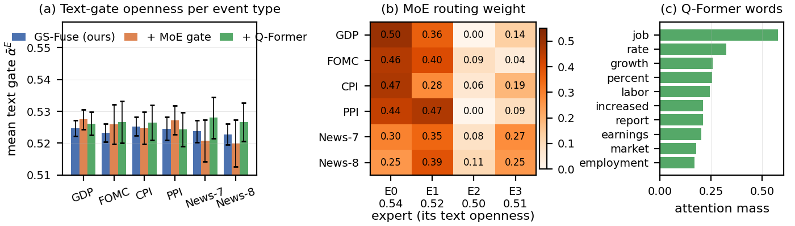
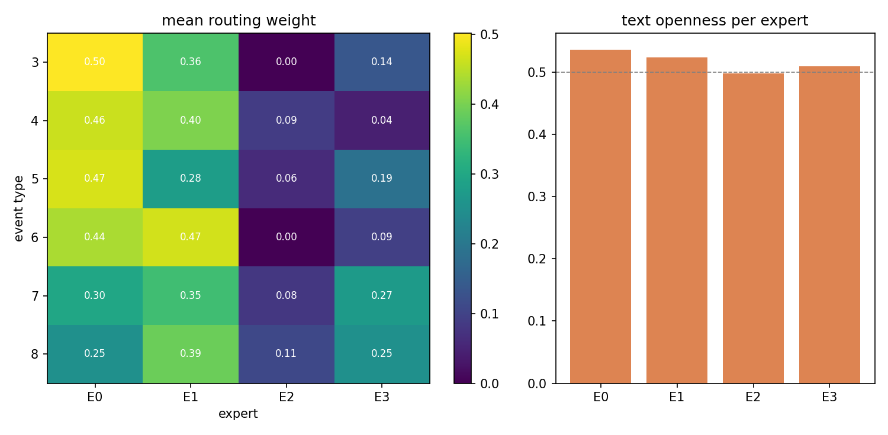
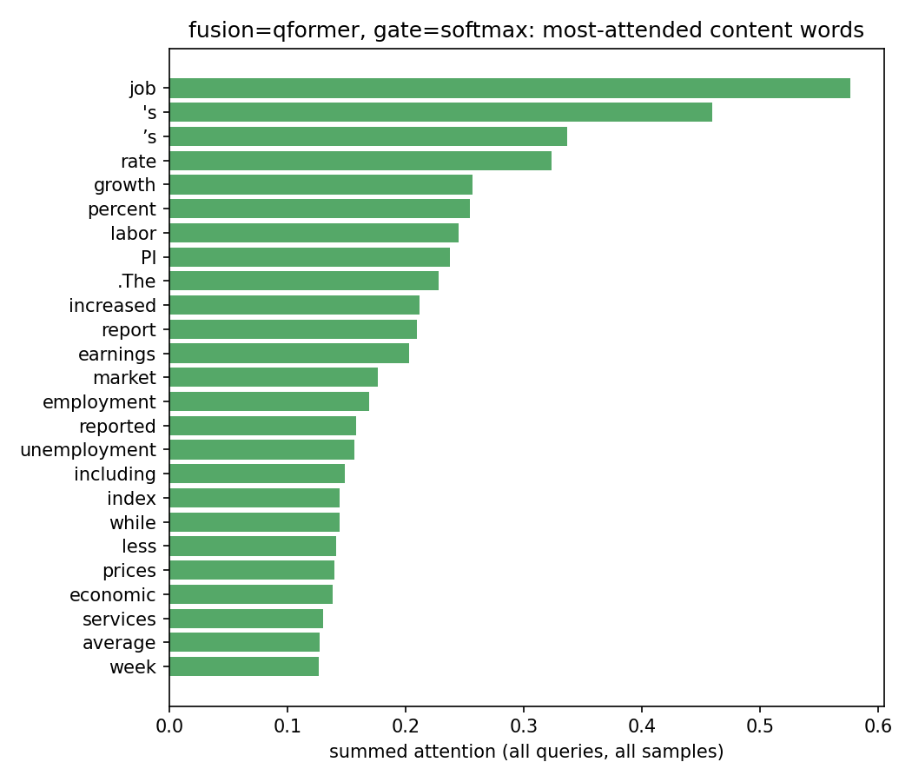
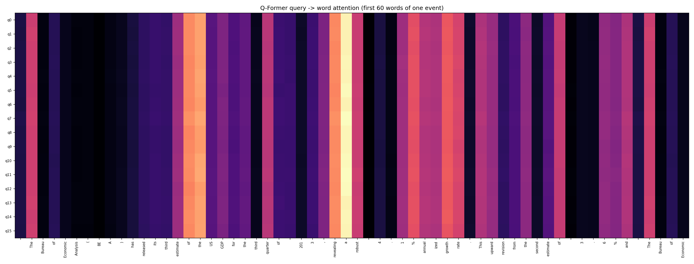
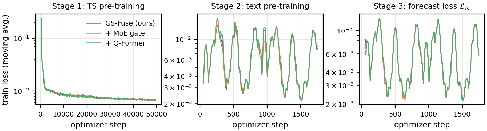

# Interpretability of GS-Fuse and its fusion variants

This note explains what the three trained models do with the event text, using the
midterm full runs (S&P 500, 5-minute bars, 35-step input, 140-step forecast, 2 epochs per
stage, Llama-3.2-1B in fp32 with TF32, MOMENT-1-large). All plots come from
`interpret.py` on 200 evenly spaced test events. The raw numbers are in
`figures/interpretability/interpretability_{baseline,moe,qformer}.json`.

| Variant | Fusion | Gate | Flags |
|---|---|---|---|
| baseline | bidirectional cross-attention | softmax over {text, TS} | `--fusion-type crossattn --gate-type softmax` |
| moe | bidirectional cross-attention | 4 expert gates, top-2 router | `--fusion-type crossattn --gate-type moe` |
| qformer | 16 learned queries (BLIP-2 style) | softmax | `--fusion-type qformer --gate-type softmax` |

## Summary

1. The text gate is nearly constant. Text openness is 0.524 ± 0.003 for the baseline
   across all 200 test events, while the Granger supervision asks it to track how much
   the text helps each sample. The correlation between gate and measured text benefit
   is 0.024.
2. The MoE router does specialize by event type. However, all four experts open the
   text gate to almost the same degree (0.50 to 0.54), so the routing does not change
   how text is fused.
3. The Q-Former uses text the most. Text lowers test MSE by 1.4%, versus 0.5% for the
   baseline, and its gate is the most correlated with the text benefit (0.067). Its
   16 queries, however, attend to the same words, and 34% of the attention lands on
   padding.

## Modality ablation (H = 140, MSE × 1e-4, training-time evaluation)

| | baseline full / TS only / text only | moe full / TS only / text only | qformer full / TS only / text only |
|---|---|---|---|
| Test | 6.32 / 6.35 / 6.74 | 6.31 / 6.37 / 6.80 | 6.33 / 6.42 / 9.79 |
| Vali | 5.80 / 5.86 / 6.17 | 5.81 / 5.88 / 6.17 | 5.83 / 5.92 / 9.64 |
| Text gain (test) | 0.5% | 1.0% | 1.4% |
| Text gate mean ± std (test) | 0.524 ± 0.003 | 0.522 ± 0.007 | 0.527 ± 0.006 |
| corr(gate, text benefit) | 0.024 | −0.007 | 0.067 |

"TS only" and "text only" keep a single branch at evaluation time. The text benefit is
Δ = MSE(TS only) − MSE(full) per sample, the quantity the Granger gate loss regresses on.

## 1. Gate openness per event type



Panel (a) shows the mean text-gate openness per test event type, with standard
deviation bars. Across GDP, FOMC, CPI, PPI and the two news streams, the baseline moves
by less than 0.003. A gate that "listened" to the text would open more for high-surprise
releases than for routine news. Per-variant versions of this plot are in
`gate_text_by_event_type_{baseline,moe,qformer}.png`.

## 2. MoE routing

Panel (b) shows the routing weight per event type. The bottom row gives each expert's
mean text openness.

- Official releases (GDP, FOMC, CPI, PPI) go mostly to E0 and E1 (0.75 to 0.91 combined).
- News streams spread out more and use E3 about twice as often (0.25 to 0.27).
- E2 is nearly unused (8% load) despite the Switch load-balancing loss.
- The experts open the text gate to 0.54, 0.52, 0.50 and 0.51. These are too close
  together for routing to matter, so the router has learned what kind of event it sees
  but not how to treat it differently.



## 3. Q-Former attention

Panel (c) and the plot below list the content words (stop-words removed) that receive the
most query attention, summed over the 200 events. The top words are *job, rate, growth,
percent, labor, increased, report, earnings, market, employment*, which is macro
vocabulary that matches the release types.



The heat map below shows the 16 queries (rows) attending over the first 60 words of a GDP
release. All rows are almost identical: the queries have collapsed onto the same
positions ("estimate", "robust", "%", "growth"). The bottleneck therefore behaves like
one query, not 16. Before counting stop-words, the largest attention mass goes to
"the", ",", "." and padding tokens (34% on padding on average).



## 4. Training dynamics



In stages 2 and 3, the loss repeats the same shape every epoch (874 steps). The training
loader is not shuffled and events arrive grouped by type, so each epoch shows the model
the same sequence of event regimes. This can bias the gate toward the event types seen
last.

## Caveats

- **Duplicate price windows.** All events are stamped at 08:30 of their date, including
  FOMC releases that actually come out at 14:00. News folders cover nearly every trading
  day. As a result, 90.7% of test events (94.1% of validation events) share the exact
  input and target window of some training event. The gate and attention patterns above
  are therefore measured mostly on price paths the model already saw during training.
- **Split by event type.** The positional split puts different event types in each
  split. The validation set is 96% news-9.
- **Single seed.** Each variant was trained once without fixed seeds.

## Next steps suggested by these plots

- Give the gate and router an explicit surprise signal, such as realized volatility of
  the input window or an event-type embedding, and measure success with
  corr(gate, text benefit), not only MSE.
- Add a query-diversity term (for example, orthogonality or attention-entropy across
  queries) and mask padding for the Q-Former.
- Re-run everything with the chronological split (`split_by_time=True` in
  `data/dataloader.py`) after deduplicating shared windows, with a shuffled training
  loader and 3 seeds.

## Reproducing

Plots are written automatically at the end of training when `--interpret-samples N > 0`
(the default in `scripts/run_variants.sh`). For an existing checkpoint, run:

```bash
python interpret.py --model-path outputs/full/qformer/best_model.pth \
  --fusion-type qformer --gate-type softmax \
  --moment-path pretrained/MOMENT-1-large --text-model-path pretrained/Llama-3.2-1B \
  --text-cache cache/text_inst_llama1b_tf32.pt --tf32 --no-4bit \
  --split test --n-samples 200 --out-dir outputs/interpret/qformer
```

`--no-4bit` is needed for the midterm checkpoints because they were trained with the text
backbone in full precision. The branch default (`USE_4BIT = True`) loads it in 4-bit
instead.
