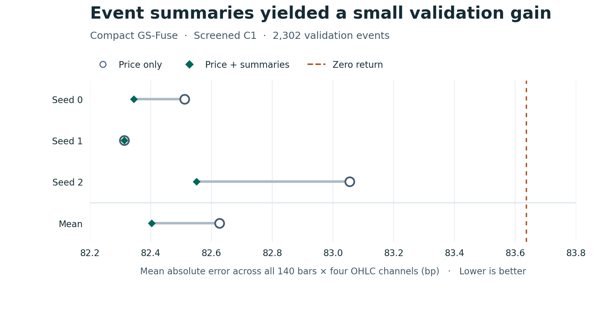

# Compact GS-Fuse: full-path validation results

**Adding event summaries lowered mean validation MAE from 82.626 to 82.403 bp (0.223 bp, or 0.27%).** Two of three seeds improved. The other selected epoch 0 for the residual, which leaves the price-only forecast unchanged. This is a small validation gain, not a result on held-out test data.

| Training seed | Price only | Price + summary | Improvement |
| --- | ---: | ---: | ---: |
| 0 | 82.511 | 82.344 | 0.166 |
| 1 | 82.313 | 82.313 | 0.000 |
| 2 | 83.054 | 82.551 | 0.504 |
| Mean | 82.626 | 82.403 | 0.223 |

The zero-return validation baseline was **83.636 bp**. Improvements are calculated from unrounded values; lower MAE is better.

## What was measured

- **Target:** All 140 future bars and four OHLC channels; equal-weight MAE over events, bars, and channels. Each value is a basis-point log return from the same last observed close. The model sees 35 past bars.
- **Setup:** The compact price model is held fixed within each seed while a small text encoder and a residual head learn a correction. The vocabulary and return scale were fit on training data only; checkpoints were selected by lowest whole-path validation MAE, with epoch 0 eligible. Six runs completed on an RTX 4060 (PyTorch 2.5.1+cu124), batch size 32. The selected price/residual epochs were 1/3, 2/0, and 1/2 for seeds 0, 1, and 2.
- **Text control:** On 2,250 of 2,302 validation events with an eligible earlier-date donor, matched text beat the average of three shuffled draws by **0.704**, **0.000**, and **0.051 bp** for the three training seeds. The overall diagnostic is driven mainly by seed 0; one shuffle draw at seed 2 was slightly better than matched text. No uncertainty interval was calculated here.
- **Endpoint vs. path:** The close at bar 140 is one value. Its validation MAE from these same checkpoints was 108.501 bp for price only and 107.919 bp with summaries, averaged across seeds. The [earlier endpoint-only study](RAW_NEWS_RUNBOOK.md) reported 108.627 bp without summaries and 107.849 bp with the frozen-price residual at that horizon. Neither endpoint result should be compared with a full-path MAE.

## Provenance and limits

The frozen screened C1 split has 6,167 train, 2,302 validation, and 2,236 test events. Timing policy: `category4_1400_strict_before`. Snapshot SHA-256: `049aa089d2eaa77644be5deba3abad3fa33c0a18b4375553664cafc71370c2bf`. Manifest SHA-256: `1b04373a4361238b09c0b1d952163973403d2d7839dbb9e7215c429af14b23d1`. Local validation used the campaign checkout at `794e3a61cf4977750a4c42707175c21364c94e36` with local changes; each run's `resolved_config.json` records file-level hashes and the same-seed price checkpoint identity where applicable. See the [runbook](RAW_PATH_RUNBOOK.md).

The experiment trained its own encoder and did not run Llama or use cached Llama embeddings. It read the archive's `full_summary` files, not original articles. [CAMEF identifies its files with this suffix as Llama-generated summaries](https://github.com/lakebodhi/CAMEF#-file-naming-convention); this does not verify provenance for every GS-Fuse category. Availability of the text at each forecast origin and near-duplicate exclusion remain unverified.

These six runs did **not** score test data. [R3's 80.615 bp](../../results/adaeze-screened-r3-h200-v2/summary.md) is a published **test** score. The compact model shares the forecast target and scoring metric, not R3's model or training objective. The [separate locked test evaluation](RAW_PATH_TEST_RESULTS.md) scores all six saved checkpoints; the validation gain did not carry over. Do not reselect or retrain on test results.
