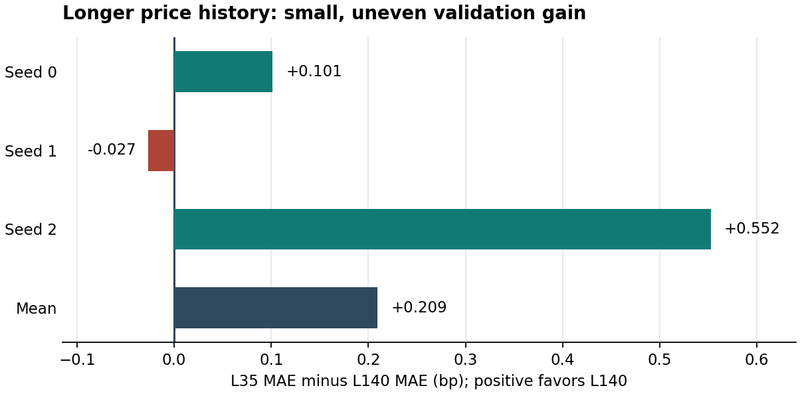

# compact-context-v1: 35 vs. 140 past price bars

**Completed on RTX 4060; validation only.** Increasing the price history from
35 to 140 bars lowered mean whole-path validation MAE by **0.209 bp**. Two
seeds improved and one got slightly worse. L35 remains the forward reference;
L140 is a candidate, not a new default.

| Seed | L35 MAE (bp) | L140 MAE (bp) | L35 minus L140 (bp) |
| --- | ---: | ---: | ---: |
| 0 | 82.511 | 82.409 | +0.101 |
| 1 | 82.313 | 82.339 | −0.027 |
| 2 | 83.054 | 82.502 | +0.552 |
| Mean | **82.626** | **82.417** | **+0.209** |

Lower MAE is better. Differences use unrounded values; positive favors L140.
The zero-return validation reference was **83.636 bp**.

## Design and checks

- Reference: [the compact price-only baseline](../../experiments/improvement-v1/RAW_PATH_TEST_RESULTS.md).
  Both price-only arms retrained from scratch for matched seeds 0, 1 and 2;
  only the input length changed. Both used the same causal architecture,
  width 32, train-only return scale, batch 32, up to 30 epochs, and validation
  whole-path MAE selection with patience 5 and epoch 0 eligible.
- Both arms retained all **6,167 train / 2,302 validation** events, identical
  origin/target windows, and zero shared price bars across splits. All 2,236
  canonical L35 test windows were protected and none were scored. The output
  is H140 × 4 OHLC, in basis-point log returns from the last observed close.
- Six full fits and setup took about **300 seconds** on the RTX 4060 under
  PyTorch 2.5.1+cu124. Peak PyTorch-allocated CUDA memory per arm was
  about 19.6 MiB for L35 and 24.6 MiB for L140; these are not total board usage.
- This run started from source commit `9807803` with local ablation code.
  The returned source-file digests identify the code used; the trainer in
  this PR matches the reported digest. The local job had no scheduler ID.
  See [provenance](provenance.json), [metrics](metrics.json), and the
  [exact runbook](../../experiments/compact-ablation-v1/README.md).

## Limits and next step

The gain is small and concentrated in seed 2. No paired date-block interval was
computed; the saved validation predictions are sufficient for that next check,
without retraining. Keep test closed for this ablation. The existing date-based
forecast-origin convention was held fixed, not certified; no news text was read.
Predictions, checkpoints, and raw logs are not in this public result bundle.

Recreate the figure with `python results/compact-context-v1/make_figure.py`.
Raw artifacts: retained on the originating laptop; shared-compute copy and
aggregate Drive backup pending at preparation.
