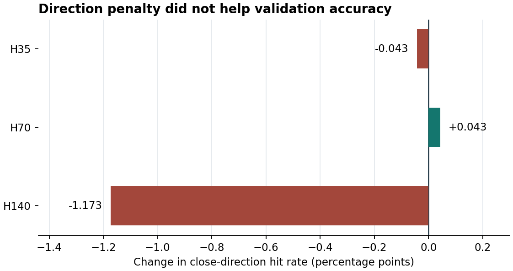

# compact-direction-v1: adding a direction penalty

**Completed on RTX 4060; validation only. Keep Smooth L1 as the default.**
Adding this direction penalty increased mean validation whole-path MAE from
**82.626 to 82.674 bp** (+0.048 bp; lower is better). It also reduced H140
close-direction accuracy from **60.96% to 59.79%**. Both effects went in the
same direction in all three seeds. H35 and H70 direction changes were near zero.

| Seed | MAE change (bp) | H35 direction change (pp) | H70 (pp) | H140 (pp) |
| --- | ---: | ---: | ---: | ---: |
| 0 | +0.045 | +0.087 | 0.000 | −1.651 |
| 1 | +0.093 | +0.217 | +0.087 | −0.304 |
| 2 | +0.006 | −0.434 | +0.043 | −1.564 |
| Mean | **+0.048** | **−0.043** | **+0.043** | **−1.173** |

All changes are treatment minus reference, calculated before rounding.
Positive MAE changes are worse; positive direction changes are better.

## Design and limits

Both arms used the same independently seeded compact price architecture,
35 observed bars, 140 future OHLC bars, the same initial weights within
each seed, and the same 6,167 training and 2,302 validation events from
canonical screened C1. Only the training objective changed: Smooth L1
versus Smooth L1 plus weight-1 sign loss at H35/H70/H140 close. Exact-zero
actual close returns were excluded from direction scoring. Both arms
selected by validation whole-path MAE, with epoch zero eligible. Price
returns were normalized with the canonical training-only scale.

Six fits and setup took about four minutes on the RTX 4060. No news,
checkpoint selection on test, or test scores. These are mixed-objective
validation findings for one penalty and one selection rule, not evidence
against all direction losses. No paired date-block interval was computed.
The source report marks the working tree dirty; it does not identify which
additional files caused that flag. See [provenance](provenance.json) for exact
source hashes and [metrics](metrics.json) for the machine-readable results.

[Runbook](../../experiments/compact-direction-v1/README.md) · Regenerate the
figure with `python results/compact-direction-v1/make_figure.py`.
