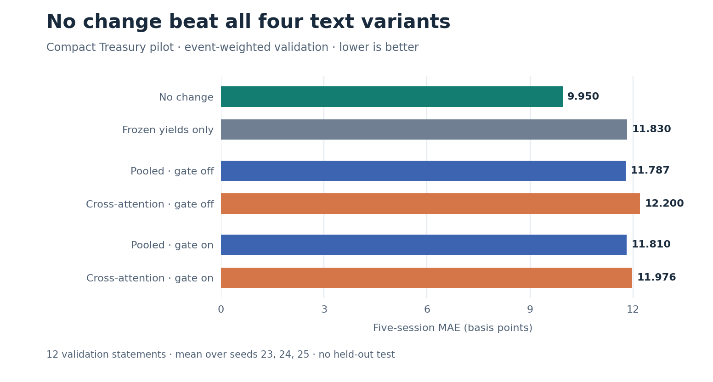

# Compact Treasury: pooling vs. cross-attention, with and without a gate

**The run completed. No change won on MAE and MSE.** Cross-attention was worse than paired pooling, whether the gate was off or on. The gate softened the cross-attention penalty, but did not make the cross-attention model better than pooling or the no-change reference.

| Arm | Gate | Validation MAE (bp) | MSE (bp²) | Endpoint DHR |
|---|---|---:|---:|---:|
| No change | — | **9.950** | **170.530** | 0.0% |
| Frozen yields only | — | 11.830 | 226.534 | 40.5% |
| Pooled text | Off | 11.787 | 224.864 | 40.5% |
| Cross-attention | Off | 12.200 | 237.349 | 40.5% |
| Pooled text | On | 11.810 | 225.776 | 40.5% |
| Cross-attention | On | 11.976 | 230.879 | 40.5% |

Cross-attention minus pooled MAE was **+0.413 bp ungated** and **+0.166 bp gated**, worse in all three seeds and 10 of 12 seed-averaged statements in each pairing. The event-paired bootstrap sensitivity ranges were [0.256, 0.557] and [0.096, 0.231] bp, respectively. This resampled the 12 statements after averaging each pair over the same three seeds; it is descriptive, not a confirmatory inference. There was no temporal blocking or multiplicity adjustment; the seeds and the overlapping origins are not independent evidence.

The learned gate reduced cross-attention MAE by 0.224 bp; a fixed half gate already reached 12.003 bp versus 11.976 bp for the learned gate. The gate slightly worsened pooled MAE by 0.023 bp. Matching the actual statement did not beat its prior-statement substitution on mean MAE in any of the four text arms; those differences were under 0.005 bp. Replacing the varying cross-attention query with its fixed train mean reached 11.822 bp using the trained checkpoint, better than its normal 12.200 bp but still worse than no change. This is a diagnostic, not a separately fitted model. The attention weights did respond to the yields query: average total-variation distance across later versus first origins within the same validation statement was about 0.0095 across the seeds. Query responsiveness did not translate into better forecasts.

The zero forecasts have 0% DHR by construction under this metric: exact-zero predictions miss nonzero moves, and true zeros are excluded. The identical 40.5% DHR across trained and control arms does not offset their worse magnitude errors. No change also led on first-origin MAE (11.383 bp).

**Decision:** Keep no change as this pilot's reference and do not promote the gate or attention. This is a small, repeatedly used validation set of 12 archived Fed statements, 60 windows, and official daily Treasury yields. It is not a held-out test, C1/intraday equity result, verified live-news availability measurement, or a general verdict on text conditioning.

[Protocol and commands](../../experiments/improvement-v1/COMPACT_TREASURY_CROSSATTENTION_PROTOCOL.md) · [Exact sanitized metrics](metrics.json) · [Provenance](provenance.json)
