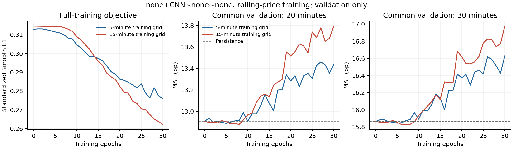

# Price CNN trained on rolling market windows

Owner Nicole. Completed on one H200; scheduler exit 0, allocated wall time 6m43s. Training and validation only. The original frozen checkpoints were preserved.

## What changed

The user requested that the price forecaster use the available price history rather than only the price windows associated with announcements. The prior `none+CNN~none~none @ train:FED-PX-REL5-v1` used 978 announcement-aligned windows. The new `none+CNN~none~none` uses rolling windows across the entire permitted training period:

| Training cohort | Training windows | Dates | Completed updates | Selected epoch |
|---|---:|---:|---:|---:|
| `SPX-PX-GRID5-v1` | 204,694 | 2,865 | 95,970 | 5 |
| `SPX-PX-GRID15-v1` | 68,219 | 2,865 | 31,980 | 8 |

Five and fifteen minutes denote **anchor strides**, not forecast horizons or input durations. Both fits retain the same 35-bar OHLC input, five-minute processing lag, and 20/30-minute endpoint Close-return labels. The entire input/anchor/target support is contained within the corresponding time split. The target must fit within the actual exchange session; missing intraday bars are excluded. The inherited price-cleaning rule retains the original 09:30-through-16:00 bar-start filter for historical inputs. Training and rolling validation share zero price bars. Validation ends before the earliest reserved-test price bar. [Audit](audit.json)

Both use batch 64, AdamW at 0.001 with weight decay 0.001, gradient clipping 1 and 30 epochs. RMS scaling is fit on GRID5 training and shared by both fits. Lowest 20-minute MAE on the **common GRID5 rolling validation** selects each checkpoint. Original Fed validation is scored only after this selection. This is a training-population package: population, fitted scaling and validation-selection population differ from the prior event-only run. It does not isolate a pure sample-count effect. [Fixed protocol](../../experiments/dense-price-grid-v1/config.json)

## Common rolling-price validation

Both selected checkpoints are scored on `SPX-PX-GRID5-v1 val`: 40,548 windows on 569 dates, with unit weight per anchor. Lower MAE is better.

| Architecture and training cohort | MAE20, bp | MAE30, bp |
|---|---:|---:|
| `Persistence @ score:SPX-PX-GRID5-v1 val` | 12.9076 | 15.8647 |
| `none+CNN~none~none @ train:SPX-PX-GRID5-v1 → score:SPX-PX-GRID5-v1 val` | 12.8874 | 15.8448 |
| `none+CNN~none~none @ train:SPX-PX-GRID15-v1 → score:SPX-PX-GRID5-v1 val` | 12.8773 | 15.8309 |

The selected GRID15 fit has a small validation gain over Persistence: **0.03027 bp at 20 minutes and 0.03374 bp at 30 minutes**, approximately 0.23% and 0.21% relative MAE reduction. Ten-date-block paired 95% intervals are [0.01449, 0.04981] and [0.00345, 0.06377] bp. Five-date intervals also exclude zero. These intervals describe the selected forecasts and **do not correct for checkpoint selection or comparison of strides on this validation set**. This is exploratory validation evidence, not an independent held-out forecasting claim.

For GRID5 training, the corresponding gains are 0.02020 and 0.01987 bp. The 20-minute 5-/10-date intervals exclude zero; the 30-minute intervals span zero. Full values and definitions are in [metrics.json](metrics.json).

## Matched announcement validation

The same selected checkpoints are separately scored on `FED-PXTX-ALL-REL5-v2 val`: 149 releases, with concurrent-release weights recomputed within this population.

| Architecture and training cohort | MAE20, bp | MAE30, bp |
|---|---:|---:|
| `Persistence @ score:FED-PXTX-ALL-REL5-v2 val` | 16.1546 | 20.4842 |
| `none+CNN~none~none @ train:SPX-PX-GRID5-v1 → score:FED-PXTX-ALL-REL5-v2 val` | 16.2482 | 20.5778 |
| `none+CNN~none~none @ train:SPX-PX-GRID15-v1 → score:FED-PXTX-ALL-REL5-v2 val` | 16.2329 | 20.5799 |

Neither selected fit improves the point estimate on this announcement population. All paired 5-/10-date intervals against Persistence span zero. This does not identify a cause: the ordinary rolling-price population and the announcement population differ, and improved general-price validation does not establish announcement-specific forecasting competence.

## Training behavior

The complete [epoch traces](learning-curves.csv) show continued training-loss reduction with worsening late validation error. At epoch 30, full-training standardized Smooth L1 is 0.275881 for GRID5 and 0.262160 for GRID15; common validation MAE20 is 13.4369 and 13.7949 bp, respectively. These are **final-epoch states**, not the selected checkpoints in the tables above. The curves establish ongoing fitting and late validation degradation. They do not certify a training-loss plateau or show that further updates would improve generalization.

Every optimizer-step loss/gradient norm, each epoch's continuation state, selected weights and per-window forecasts are retained in private run storage and the verified local backup. The new runner avoids the original diagnostic gap of retaining only validation summaries.

## Verification, scope and next question

Runtime source commit `3254193cb007088212a77011a03c6dbeb3d775cd`; source-file hashes match the collected metrics. Nineteen output files passed remote-to-local SHA256 verification. Both selected checkpoint hashes were independently checked. Full-grid and matched-release MAEs were independently recomputed from saved per-example predictions. Four focused clock/purging/stride/missing-bar tests, a real-input audit, a full-input zero-update CPU smoke, and the completed GPU execution provide distinct verification evidence. [Provenance](provenance.json)

Adjacent rolling windows overlap and are correlated. The original clock/bar-start assumptions remain. Neither a new text encoder nor a fusion architecture was trained here; the reserved test was not scored. The next research question is whether adapting the price representation trained on all prices to the announcement task improves announcement validation. That comparison is proposed, not executed by this run. Do not infer a general absence of textual information from these price-only results.

## Aggregate evidence backup

The [versioned Drive ZIP](https://drive.google.com/file/d/1oicRd6YPws6966Ejl7-_pIiwmRlL_LvP/view?usp=drivesdk) contains both aggregate result packs and the fixed dense-training protocol from commit `743c24a7b2a986c0ab2d8c25c98aeedf2954f0c2`. Its 605,603-byte size, MIME type, filename and Results/Evidence parent were verified by destination metadata readback. The connector did not expose a destination checksum; [receipt](backup.json) records local hashes and that verification limit. Full prediction, optimizer-state and checkpoint backups are separate private artifacts.
