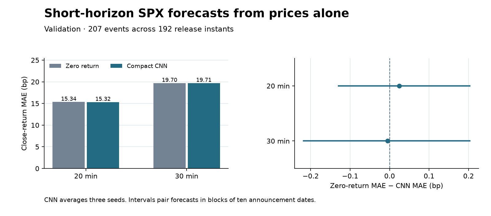

# Compact price-only Fed/SPX forecasts at 20 and 30 minutes

**The compact CNN and zero return had nearly the same validation MAE.** The
CNN reduced 20-minute error by 0.025 bp and increased 30-minute error by
0.005 bp on average across three seeds. Both paired intervals include zero.

Owner: Adaeze Ilodianya. Run `fed-spx-endpoints-price-v1` completed on validation
on November 23, 2026. [Runbook](../../experiments/fed-spx-endpoints-price-v1/README.md)
· [Exact metrics](metrics.json) · [Provenance](provenance.json)

## Validation result

| Horizon | Zero-return MAE | Mean CNN MAE | Zero minus CNN with paired 95% interval | Mean CNN direction accuracy |
|---|---:|---:|---:|---:|
| 20 minutes | 15.343 bp | 15.318 bp | +0.025 bp [−0.131, +0.205] | 54.5% |
| 30 minutes | 19.701 bp | 19.706 bp | −0.005 bp [−0.219, +0.205] | 52.4% |

207 rows across 192 release instants and 165 dates. Positive gain favors the
CNN. Each instant receives unit weight, and the CNN column averages the three
seed scores. The paired interval resamples blocks of ten announcement dates
and averages the per-event losses across seeds before resampling. Five-date
blocks also span zero. Direction excludes realized zeros, leaving 207 and 206
eligible rows at 20 and 30 minutes. The zero-return control is always flat.

The same two-output model uses 35 pre-release OHLC bars for both horizons.
Each seed trained for 30 epochs on the laptop RTX 4060. The lowest 20-minute
validation MAE selected epochs 17, 1 and 1 for seeds 0, 1 and 2. Fitting and
scoring took about 7 minutes 48 seconds. All three checkpoint hashes matched,
and replay produced the saved forecasts exactly when the input scale was
restored as `float64` before converting the scaled inputs to `float32`.

## Input and text-version checks

The real-data label builder retained 978 train and 207 validation rows for
both horizons. It checked the frozen files, the XNYS session and exact
five-minute grid, and the separation of the train and validation bars,
including the new decision-time Close. The overlap count was zero. The
origin Close serves as the label denominator. The model inputs end by the
release time. The provider's bar-start convention and clock remain
empirically supported assumptions.

The [historical text audit](text-audit.json) used the same price-eligible IDs
and cutoff timestamps. An archived capture had to precede the forecast origin
by at least five minutes and match the catalog's exact text or PDF hash. The
as-of index returned no timely capture for 80 rows and refused connections for
1,105. A separate index reported 101 nearest captures after the cutoff before
rate limiting. A timely index entry for one validation testimony was located,
but the replay could not be retrieved to compare its content. **Zero exact
versions were confirmed.** The lookup and replay limits leave unresolved
cases, so these counts describe evidence coverage.

The matched text run remains pending. This price-only run supplies a reference
on the broader price-eligible cohort. A matched text experiment requires
fitting its price-only counterpart on the verified shared rows. The held-out
split remained reserved.

Regenerate the figure with `python results/fed-spx-endpoints-price-v1/plot_validation.py`.
