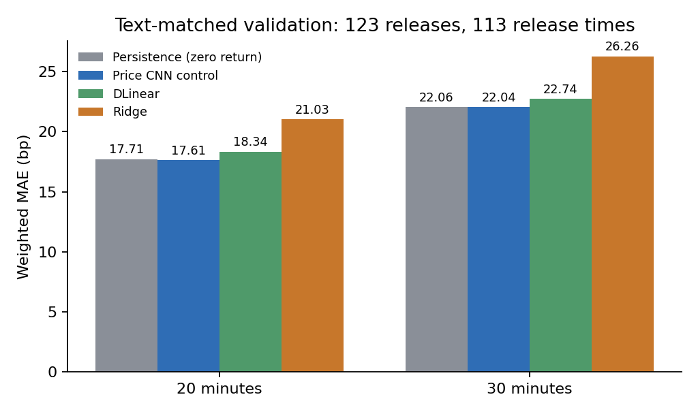

# Frozen price-only control on the text-matched Fed/SPX validation set

**On the 123 text-verified validation releases, the frozen price CNN and persistence (zero
return) have nearly the same error.** The CNN is 0.08 bp better at 20 minutes and 0.002 bp
worse at 30 minutes, and both paired intervals include zero. DLinear and ridge are worse than
persistence. For this target, persistence (the price stays at its decision-time Close) is the
zero-return forecast.

Owner: Adaeze Ilodianya. Run `fed-spx-matched-control-v1`, scored November 23, 2026 on
validation only. Test was not loaded. [Exact metrics](metrics.json) ·
[Scoring script](../../scripts/score_fed_spx_matched_control.py)



## Result

| Forecast | MAE 20 min | MAE 30 min | Gain over zero, 20 / 30 min (95% interval, 10-date blocks) |
|---|---:|---:|---|
| Persistence (zero return) | 17.707 bp | 22.058 bp | — |
| **Price CNN control** (3-seed average forecast) | 17.615 bp | 22.042 bp | +0.082 [−0.143, +0.348] / −0.002 [−0.318, +0.349] |
| DLinear (3-seed average forecast) | 18.340 bp | 22.736 bp | −0.684 [−1.321, −0.157] / −0.754 [−1.465, −0.085] |
| Ridge (α = 10) | 21.027 bp | 26.263 bp | −3.32 [−6.39, −0.91] / −4.21 [−8.65, −1.19] |

123 releases at 113 release times on 105 dates. Each release time has unit weight within
this cohort. Positive gain favors the forecast. Five-date blocks give similar intervals.
Averaged over seeds instead of over forecasts, the CNN MAE is 17.625 / 22.060 bp and its
direction accuracy is 50.1% / 48.5%, close to chance.

Restricting to the 27 releases with the strictest evidence (official record or pre-cutoff
archive copy), persistence has 13.98 / 17.66 bp, the CNN 14.10 / 17.99 bp and DLinear 14.97 / 18.70 bp. That subset is
too small for date-block intervals.

## What the control is

The control is the three-seed compact CNN from
[`fed-spx-endpoints-price-v1`](../fed-spx-endpoints-price-v1/summary.md), trained on all
978 price-eligible train releases with prices only. It is frozen: the checkpoint hashes match
that run, and a CUDA replay reproduced its saved validation forecasts exactly. Re-scored on
all 207 price-eligible validation rows, it reproduces the published numbers.

The text arm must keep this price model frozen and add a text component trained on the 160
text-verified train releases. With the text component off it must reproduce these forecasts.
Both arms are then compared on the same 123 validation releases with the same weights and
intervals. The per-event control forecasts are in
`downloads/fed-spx-matched-control-v1/val-matched-control-forecasts.csv` (not committed),
SHA-256 recorded in the metrics.

DLinear was fitted on the same 978 train releases with the settings of the historical Fed/SPX
DLinear run ([config](../../experiments/fed-spx-matched-control-v1/dlinear.config.json): 50
epochs, cosine schedule, squared plus 0.1 × absolute loss, three seeds). It is channel-independent,
so the 20/30-minute forecast is read from its Close-channel output. The last epoch is kept, so
validation played no part in fitting it. Its seed-averaged MAE is 18.39 / 22.81 bp, and its
direction accuracy is 42.2% / 48.5%. With five-date blocks the 30-minute interval reaches +0.02 bp.

Ridge was refitted on the same 978 train releases and the 20/30-minute target, using the
standardized 35 × 4 price inputs and the α from
[`fed-spx-price-baselines-v1`](../fed-spx-price-baselines-v1/summary.md).

## Limitations

- **Validation was used to pick each seed's epoch** (on the 207 price-eligible rows, which
  contain these 123), so validation scores are optimistic. The held-out test is the unbiased check.
- Validation is small. Intervals of about ±0.3 bp mean only a text gain of roughly half a basis
  point or more could register.
- The cohort includes the inferred evidence classes; keep the evidence class in any comparison.
- The bar clock is empirically supported, not documented by the data provider.

## Reproduce

```sh
PYTHONPATH=downloads/fed-spx-deps python scripts/score_fed_spx_matched_control.py \
    --price-csv ../fed-person3/downloads/SP500.csv --device cuda \
    --out-dir results/fed-spx-matched-control-v1 --forecast-dir downloads/fed-spx-matched-control-v1
python results/fed-spx-matched-control-v1/plot_validation.py
```
