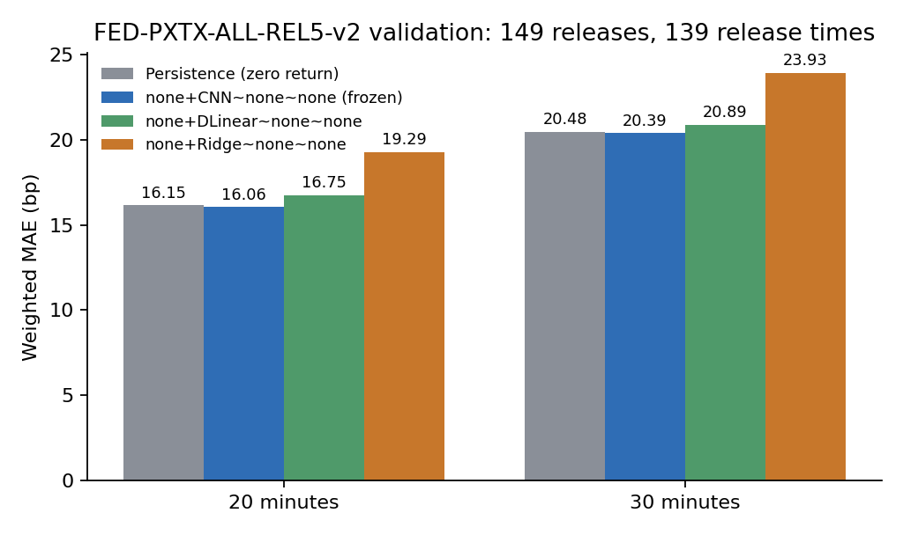

# Price-only baselines on `FED-PXTX-ALL-REL5-v2` validation

**On the 149 text-verified validation releases of `FED-PXTX-ALL-REL5-v2`, the frozen
`none+CNN~none~none` ties `Persistence`.** Its gain is +0.088 bp at 20 minutes and +0.054 bp at
30 minutes, and both paired intervals include zero. `none+DLinear~none~none` and
`none+Ridge~none~none` are worse than `Persistence`.

Owner: Adaeze Ilodianya. Run `fed-spx-matched-control-v2`, scored November 23, 2026 on validation
only; test was not loaded. It repeats [`fed-spx-matched-control-v1`](../fed-spx-matched-control-v1/summary.md)
on the corrected v2 cohort (see [evidence v2](../fed-spx-evidence-v2/README.md)). Training is
unchanged: every forecaster was fit on `FED-PX-REL5-v1` train (978 releases).
[Exact metrics](metrics.json)



| Comparison label | MAE 20 min | MAE 30 min | Gain over `Persistence`, 20 / 30 min (95% interval, 10-date blocks) |
|---|---:|---:|---|
| `Persistence @ score:FED-PXTX-ALL-REL5-v2 val` | 16.155 bp | 20.484 bp | — |
| `none+CNN~none~none @ train:FED-PX-REL5-v1 → score:FED-PXTX-ALL-REL5-v2 val` | 16.057 bp | 20.392 bp | +0.088 [−0.111, +0.321] / +0.054 [−0.222, +0.350] |
| `none+DLinear~none~none @ train:FED-PX-REL5-v1 → score:FED-PXTX-ALL-REL5-v2 val` | 16.751 bp | 20.892 bp | −0.665 [−1.214, −0.195] / −0.531 [−1.221, +0.160] |
| `none+Ridge~none~none @ train:FED-PX-REL5-v1 → score:FED-PXTX-ALL-REL5-v2 val` | 19.295 bp | 23.928 bp | −3.140 [−5.674, −1.055] / −3.444 [−7.174, −0.699] |

149 releases, 139 release instants, 125 dates; each instant has unit weight. CNN and DLinear rows
use the three-seed average forecast. Averaged over seeds instead, `none+CNN~none~none` has MAE
16.066 / 20.430 bp and direction accuracy 52.5% / 51.7%. Five-date blocks give similar intervals.
The 27-release `FED-PXTX-STRICT-REL5-v2` subset is unchanged from v1.

Limitations are the same as v1: CNN epochs were chosen on the 207 `FED-PX-REL5-v1` validation rows,
which contain these 149, so its validation score is optimistic; intervals of about ±0.3 bp mean
only a text gain of roughly half a basis point or more can register.

```sh
python scripts/score_fed_spx_matched_control.py --price-csv ../fed-person3/downloads/SP500.csv --device cuda \
    --cohort results/fed-spx-news-cohort-v2/eligible_cohort.csv \
    --out-dir results/fed-spx-matched-control-v2 --forecast-dir downloads/fed-spx-matched-control-v2
python results/fed-spx-matched-control-v2/plot_validation.py
```
