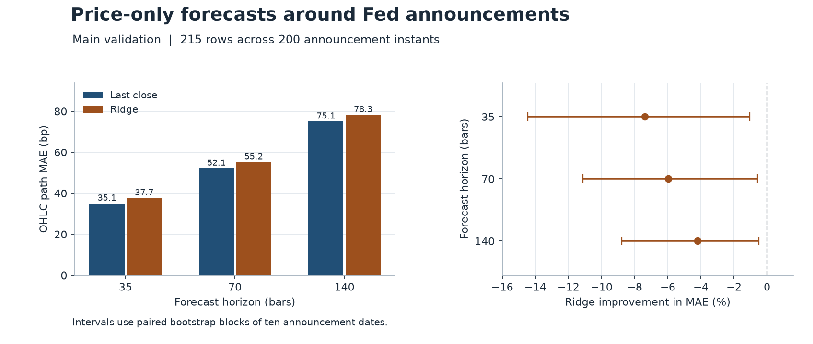

# Price-only forecasts around Fed announcements

**Last-close persistence beat ridge on main validation.**
It had lower OHLC path MAE at every horizon. At 140 bars, persistence
averaged **75.10 bp** of error and ridge averaged **78.26 bp**. The ridge
improvement was −4.21% with a 95% paired bootstrap interval of [−8.77%, −0.48%]
using blocks of ten consecutive announcement dates.

Owner: Adaeze Ilodianya. Completed on validation, November 22,
2026. [Protocol and command](../../experiments/fed-spx-price-baselines-v1/README.md) ·
[Aggregate metrics](metrics.json) · [Provenance](provenance.json)



Regenerate the figure from the published metrics with Matplotlib and NumPy:

```text
python results/fed-spx-price-baselines-v1/plot_validation.py
```

## Main validation

215 rows, 200 distinct announcement instants and 171 dates. Each instant has
unit weight. Path MAE averages over the first H bars and all four OHLC channels.

| Horizon (bars) | Last-close path MAE (bp) | Ridge path MAE (bp) | Ridge improvement with 95% interval | Ridge close direction |
|---:|---:|---:|---:|---:|
| 35 | 35.06 | 37.65 | −7.39% [−14.46%, −1.03%] | 52.5% |
| 70 | 52.13 | 55.24 | −5.97% [−11.12%, −0.59%] | 53.0% |
| 140 | 75.10 | 78.26 | −4.21% [−8.77%, −0.48%] | 50.5% |

The intervals favor persistence at all three horizons with blocks of five or
ten announcement dates. Ridge also had higher terminal close MAE at each main
horizon. Persistence always predicts a flat close, so it provides no up/down
signal. The aggregate metrics include path RMSE, terminal close MAE, direction
eligibility counts and both bootstrap block lengths.

## Flagged validation

85 rows, 81 distinct instants and 74 dates. The ridge fit is the same one used
for main validation. Flagged events include delayed or off-session starts,
press-conference transcripts, and windows with price gaps.

| Horizon (bars) | Last-close path MAE (bp) | Ridge path MAE (bp) | Ridge improvement with 95% interval |
|---:|---:|---:|---:|
| 35 | 96.15 | 96.81 | −0.69% [−8.65%, 6.33%] |
| 70 | 107.36 | 109.53 | −2.03% [−11.10%, 5.16%] |
| 140 | 127.02 | 128.91 | −1.49% [−12.74%, 7.82%] |

The flagged intervals span zero. Timing and price gaps vary within this
smaller group, so its scores are a separate sensitivity check.

## References for the text model

Persistence is a no-change benchmark. Ridge is a simple learned check of the
same price history. For the effect of adding text, compare the text model with
its own price-only counterpart. If the text model reuses Adaeze's
[compact architecture](../../experiments/improvement-v1/COMPACT_ARCHITECTURE.md),
fit its CNN on this Fed/SPX split and use that same frozen forecast with and
without the text residual. The prior compact results used screened C1.

[DLinear](../../README.md#25-standalone-unimodal-baseline-dlinear) is the team's
historical standalone price-only baseline. Its published scores use continuous
windows and a different scoring protocol. Refit DLinear on the Fed/SPX event
windows for a comparable architecture benchmark. This result pack contains
Fed/SPX scores for persistence and ridge only.

Reproduce the validation arrays and join on `event_id`. Match the
OHLC channel order, log-return anchor (last input close), horizons and cohort
weights. If text coverage changes the set of usable IDs, report the excluded
count and recompute both price baselines' evaluation scores on the same retained
IDs with weights recomputed within that cohort. Keep the original train fit fixed.

The scores are from a single validation period and a fixed ridge penalty.
The 140-bar path crosses overnight. Neighboring windows can overlap, the
pre-2019 training period includes the financial crisis, and bars past April 17,
2024 are unavailable. Price timing follows Joye's empirical bar-start
audit. The held-out test stays reserved for a frozen matched comparison.
