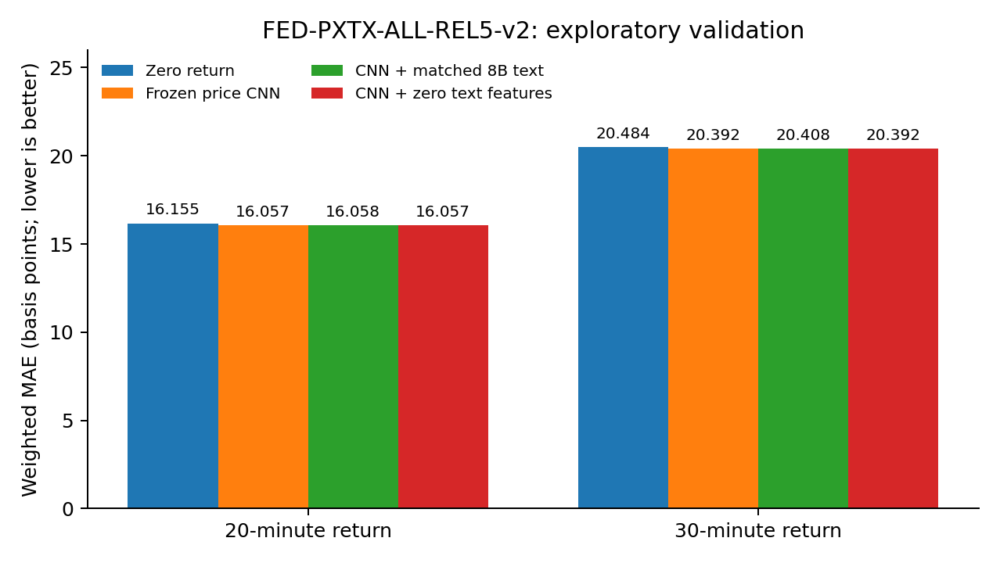
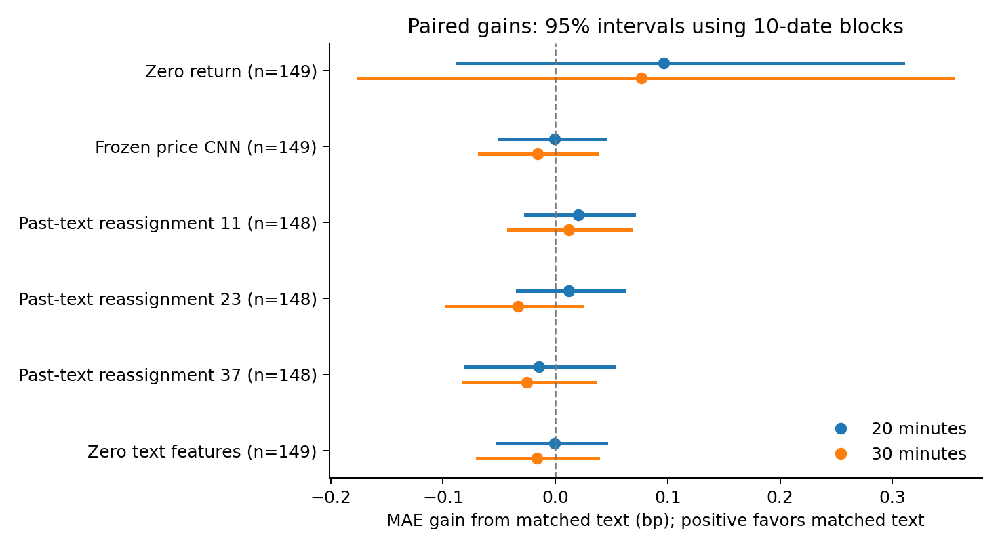

# Exact frozen 8B Fed text arm: no measurable validation gain

**Owner Nicole. Completed November 26, 2026. Training and validation only; test remains reserved.**

`Llama-3.1-8B(frozen)+CNN(frozen)~Pool~Add` learns a small additive text correction while both the official Llama-3.1-8B encoder and the existing `none+CNN~none~none` are frozen. The question is whether the matched release text improves 20/30-minute Close-return forecasts over the frozen CNN on `FED-PXTX-ALL-REL5-v2` validation.

## Finding

The matched 8B text arm has essentially the same 20-minute MAE as the frozen CNN and slightly higher 30-minute MAE. All ALL-cohort intervals for matched text versus CNN, zero features, Persistence and each past-text reassignment span zero, using either 5- or 10-date blocks. This fixed pilot establishes successful execution and an inconclusive incremental-text comparison, not a forecasting improvement.

| Forecast | MAE20 (bp) | MAE30 (bp) |
|---|---:|---:|
| Persistence (zero return) | 16.155 | 20.484 |
| Frozen CNN | 16.057 | 20.392 |
| Matched 8B text + frozen CNN | 16.058 | 20.408 |
| Zero text features + frozen CNN | 16.057 | 20.392 |

The table scores the three-seed-average forecast on the same 149 releases, 139 release instants and 125 dates. Each instant has unit total weight. Lower MAE is better. These are validation scores; checkpoint selection used validation.

## Paired comparisons

Positive gain means `loss(other) - loss(matched 8B arm)`. Intervals below use the shared scorer's 2,000 paired bootstrap replicates and 10-date blocks. They are conditional on the selected three-seed ensemble and do not correct for validation selection.

| Matched 8B arm versus | Common rows | Gain20 (95% interval), bp | Gain30 (95% interval), bp |
|---|---:|---:|---:|
| Persistence | 149 | +0.0967 [-0.0874, +0.3093] | +0.0763 [-0.1749, +0.3537] |
| none+CNN~none~none | 149 | -0.0005 [-0.0499, +0.0448] | -0.0158 [-0.0674, +0.0372] |
| shuffled-11 | 148 | +0.0207 [-0.0269, +0.0700] | +0.0118 [-0.0416, +0.0672] |
| shuffled-23 | 148 | +0.0122 [-0.0340, +0.0615] | -0.0335 [-0.0972, +0.0240] |
| shuffled-37 | 148 | -0.0144 [-0.0805, +0.0519] | -0.0254 [-0.0818, +0.0348] |
| zero | 149 | -0.0008 [-0.0513, +0.0452] | -0.0161 [-0.0693, +0.0380] |

One release has no eligible past donor. Each shuffled comparison uses 148 common releases and recomputes release-instant weights on those rows. Its matched-text MAE therefore differs from the full 149-row score. Use these paired gains rather than subtracting a shuffled subset score from the full-cohort score.

## What ran and what was fixed

- Price CNN seeds 0/1/2 were trained previously on `FED-PX-REL5-v1` (978 releases). Their original checkpoints and preprocessing were reused unchanged.
- The additive text head trained on 171 `FED-PXTX-ALL-REL5-v2` releases after dropping the two documented truncated training texts. Validation used all 149 eligible releases. No test text was opened or test forecast scored.
- Exact official base Llama-3.1-8B revision `d04e592bb4f6aa9cfee91e2e20afa771667e1d4b`: 12 model/tokenizer/license files, 16,069,729,886 bytes, all sizes and SHA256s verified. Official BF16 source weights were loaded for unquantized float32 inference. Both encoders remained frozen.
- Attention-mask mean pooling of the final hidden state, including special tokens; first 2,048 tokens. Train-only centering/scaling. The cap was reached by 62/171 training and 70/149 validation releases; later content may be omitted.
- Fixed 30 epochs plus epoch 0; AdamW, learning rate 0.001, weight decay 0.001, batch 64. Selection used weighted validation 20-minute MAE. Selected epochs were **1, 0, 0** for seeds 0/1/2. Seeds 1 and 2 retained the initial zero residual and their matched forecasts equal their loaded price forecasts exactly.
- Text-off bypass reproduced the loaded frozen CNN exactly before and after head training, and every frozen price tensor was unchanged. Compared with the separately packaged original baseline forecasts, the maximum numerical deviation was 5.82e-6 bp, reflecting execution-environment arithmetic; it is not bitwise reproduction of that external archive.
- All three matched, zero-feature and shuffled-donor outputs are finite. Donor seeds 11/23/37 select other same-split releases from different instants whose text was available by the recipient cutoff.
- One H200, scheduler exit 0, allocated wall time 7 minutes 46 seconds. Runtime code `013ca5c4e8bf595f7716aa2bf34cbddf555f4780`; torch 2.8.0+cu128, transformers 4.56.1. All eight collected original artifacts matched their remote SHA256s.

## STRICT sensitivity and limitations

On 27 STRICT validation releases, matched-text MAE is 14.091/18.077 bp versus the CNN's 14.095/17.989 and Persistence's 13.977/17.664. The matched-minus-CNN gain is +0.0036/-0.0879 bp. The 30-minute 5-date interval favors the CNN (-0.1661 to -0.0092 bp); 27 dates are too few for the scorer's 10-date interval. This small exploratory sensitivity does not establish a text improvement. STRICT filters recipients from the ALL-trained arm; it is not a separately trained STRICT experiment.

Validation was already used for the CNN and text-head selection. ALL includes inferred historical evidence classes. The text-training population is small and the token budget can omit later wording. Zero features are an input intervention with possible learned biases, not a separate retrained baseline. These results do not establish that financial text is generally useless.

## Handoff and reporting decision

Keep this bounded pilot as completed evidence; do not start a search for a positive result. The trained head selection and source identities are recorded. Final test scoring remains pending the team's evidence-class/protocol freeze in #53; this result does not close that task. Optional Gate-Learned or trainable-CNN arms were not run.

Use [paired-metrics.json](paired-metrics.json) for reported comparisons. [training-metrics.json](training-metrics.json) retains the runner's selection traces and checks; its shuffled aggregate uses a different averaging/weighting convention, so it is supplementary. [Provenance](provenance.json) records exact versions and private-artifact hashes. Numeric shared-scorer output is unchanged; only the private forecast-input path is normalized in the public copy. Raw forecasts, embeddings and checkpoints remain in Nicole's run storage and verified local backup.
