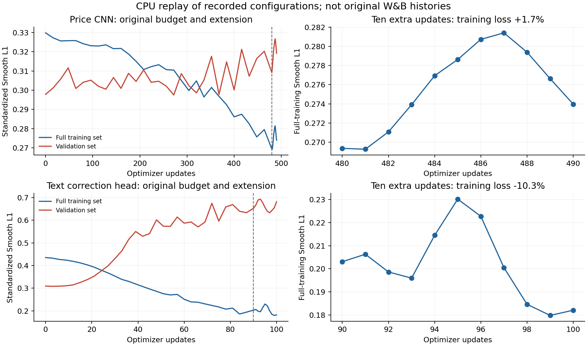

# Training diagnostic and event-window selection audit

Owner Nicole. Completed local CPU diagnostic, November 26, 2026. No GPU job and no test scoring.

## Question and protocol

The user requested an actual training-curve check and ten additional optimization updates, and asked why more than ten years of SPX prices produced only 978 CNN training windows. The original endpoint runners and exact 8B batch wrapper did not log training loss to W&B. The remote original training log contained embedding progress and final selection summaries, not training-loss curves. Original final optimizer states were not saved.

We therefore replayed the first recorded configuration of each architecture on CPU, with the original data, cached features, normalization, architecture, optimization and training order, and then performed exactly ten additional updates. This is a replay, not an exact continuation of the original CUDA execution. See [protocol](protocol.json), [metrics](metrics.json), [epoch/extension traces](training-traces.csv) and [runner](../../scripts/diagnose_fed_training.py).

## Measured training movement

| Architecture and training cohort | Original update budget | Full-training Smooth L1 before / after ten extra updates | Relative change | Validation MAE20 before / after, bp |
|---|---:|---:|---:|---:|
| `none+CNN~none~none @ train:FED-PX-REL5-v1` | 480 | 0.269360 / 0.273966 | +1.71% | 15.9541 / 16.1966 |
| `Llama-3.1-8B(frozen)+CNN(frozen)~Pool~Add @ train:FED-PXTX-ALL-REL5-v2 minus 2 exclusions` | 90 | 0.203056 / 0.182073 | -10.33% | 25.0641 / 26.1795 |

The text-head training objective still decreased materially after its original budget, while validation error increased. This is evidence against treating that endpoint as a flat training-loss plateau, and is consistent with a fitting/generalization tradeoff on this small population. It does not show that more updates improve forecasts. The price diagnostic did not produce a net training-loss reduction over its ten-update extension; that local observation does not certify convergence.

The maximum differences from the published validation traces are 0.0004164 bp for the price CNN and 0.00006915 bp for the text correction. The original validation-selected checkpoints were not replaced. Results above describe the end-of-budget replay states, not the original selected checkpoints.

## Why only 978 windows?

The frozen SPX file has 331,256 rows from January 2008 to April 2024. Existing regular-session cleaning retains 322,783 bars; 225,561 of these occur before the original training cutoff. The endpoint loader iterates Fed announcement rows, not all price bars:

1. 1,409 aligned announcement rows are assigned to training.
2. The inherited main-candidate filter admits 1,013 rows.
3. The 30-minute endpoint/session check excludes 35 rows, leaving **978 event windows**, representing 929 release instants and 787 dates.

Thus 978 does not describe the amount of available training-period price history. It describes event-conditioned subsampling. Dense rolling-window training is a new training-population comparison; the diagnostic does not train it or establish how much it will help. Adjacent dense windows will overlap, so their count is not an independent-sample count.

## Provenance and limitations

Price, alignment, catalog, feature-cache and checkpoint fingerprints are recorded in the metrics and audit. The alignment's original CRLF byte form was reconstructed in a private temporary copy and verified against the published hash; the repository CSV was preserved. Train/validation shared-bar audit is zero. Only train and validation JSONL files were opened. CPU torch 2.5.1 differs from the original text CUDA torch 2.8.0 environment. The first attempted replay used weights from the broader Fed validation population for the text subset; it was rejected and corrected to recompute unit weights within the eligible text subset before the reported replay.

Raw cached features, original checkpoints and private execution artifacts remain in the operator's existing storage. No W&B history was invented or synchronized, and no general claim about financial text follows from this diagnostic. The next authorized task is a separate rolling-price training comparison with the 5- and 15-minute anchor grids.

The combined [Drive evidence ZIP](https://drive.google.com/file/d/1oicRd6YPws6966Ejl7-_pIiwmRlL_LvP/view?usp=drivesdk) includes this result pack and the rolling-price comparison. See the shared [verified backup receipt](../dense-price-grid-v1/backup.json).
