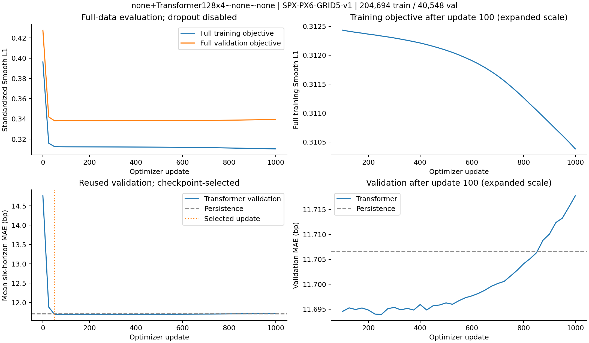

# Six-position shared-query price Transformer

Owner Nicole. `none+Transformer128x4~none~none @ train:SPX-PX6-GRID5-v1 → score:SPX-PX6-GRID5-v1 val`.
Completed on one H200, scheduler exit 0. No text training or reserved-test scoring.

## Architecture and observations

The requested backbone has **794,241 parameters**: Linear(4,128) input
embedding; four pre-LN Transformer layers with four attention heads, FFN width 512,
GELU and dropout 0.1; final LayerNorm; shared Linear(128,1) output projection.
Exactly one trainable 128-vector is expanded to six prediction positions. The
six positions predict cumulative log returns at +5/+10/+15/+20/+25/+30 minutes,
with loss on every position. Past and future share sinusoidal temporal encoding
using actual elapsed UTC minutes. Past queries cannot read future queries; future
queries can read all known historical states and target-free future queries.

The 35-bar OHLC histories retain the original five-minute processing gap. This
uses one cash-index series, without an announcement/text filter or stock panel.
All **204,694** eligible training windows and **40,548** validation windows are
used. All support stays inside the temporal partitions, with zero shared price
bars across splits. Targets have the same existing complete 30-minute support.
[Configuration](../../experiments/shared-token-transformer-v1/config.json), [audit](audit.json).

## Actual maximum batch calibration

The unique batch is capped by the training population. Ordinary training exceeded
memory at the full dataset size; its largest accepted batch at the 256-window
search resolution was 136,192.
Activation checkpointing allowed **204,694 distinct windows in
one batch**, confirmed by ten consecutive forward/backward/clipping/AdamW updates.
This is a **dataset-limited full batch**, not a measurement of an unrestricted
hardware maximum. Observations were not duplicated to inflate the batch.

BF16 autocast uses FP32 parameters and AdamW states. Each layer is tiled along
the batch axis in chunks of 8,192 for kernel/workspace control. All chunks belong
to one logical forward, one loss, one backward and one optimizer update; there is
no gradient accumulation. Peak allocated memory in the ten-update confirmation
was 22.482 GiB; PyTorch peak reserved memory was
30.711 GiB. Actual CUDA-visible device capacity was
150,111,977,472 bytes. The acceptance rule preserves at least
4 GiB or 5% of device capacity. The complete actual search is retained in
[batch-calibration.json](batch-calibration.json).

Calibration weights and optimizer states were discarded. Formal training loaded
the saved original state, used 1,000 full-batch updates (204,694,000
window presentations), AdamW with 50-update warmup and cosine LR decay, and
train-only RMS normalization. Training/evaluation peak allocated/reserved memory
was 22.506/32.342 GiB.
Formal runtime including evaluations and final scoring was 1613.5 seconds.

## Validation against Persistence

Checkpoint selection minimizes mean six-horizon MAE on reused rolling validation.
Selected update: **50**. Mean six-horizon MAE is
**11.689790 bp**, compared with
**11.706526 bp** for Persistence on the same windows.

| Horizon | Transformer MAE, bp | Persistence MAE, bp | Paired gain, bp | 10-date-block 95% interval, bp |
|---|---:|---:|---:|---:|
| +5 min | 6.55632 | 6.56170 | +0.00539 | [+0.00282, +0.00785] |
| +10 min | 9.24052 | 9.24890 | +0.00837 | [+0.00344, +0.01360] |
| +15 min | 11.19886 | 11.21460 | +0.01574 | [+0.00840, +0.02297] |
| +20 min | 12.88923 | 12.90757 | +0.01834 | [+0.00880, +0.02769] |
| +25 min | 14.41472 | 14.44171 | +0.02700 | [+0.01427, +0.03949] |
| +30 min | 15.83910 | 15.86468 | +0.02558 | [+0.01120, +0.04014] |

Positive gain means lower error than Persistence. Both 5-/10-date block intervals
are in [metrics.json](metrics.json). These intervals condition on checkpoint
selection and do not adjust for repeated use of validation. They are exploratory,
not independent test evidence. Adjacent windows overlap and are correlated.
Architecture, six-target supervision, batch and optimizer settings change together
relative to the earlier CNN; this is a package comparison.

## Complete training diagnostics

Complete train/validation evaluation occurs at update zero and every 25 updates,
with dropout disabled. Train Smooth L1 changed from
0.396312165 initially to 0.310380782
at update 1,000. Over the final 100 updates it changed from
0.310831894 to 0.310380782
(-0.1451%). Final mean validation
MAE was 11.717759 bp, distinct from the selected checkpoint's
11.689790 bp. Training loss declined at every logged assessment from update 900 through 1,000;
there is no observed flat training-loss plateau over that interval. Validation
error increased across those same assessments. This shows continued fitting with
late validation deterioration; extending training alone is not supported by these
validation results. The relative mean-MAE gain of the selected checkpoint over
Persistence is only 0.143%, and is not independent held-out evidence.

[All full-data evaluations](learning-curves.csv) and [all optimizer updates](optimizer-steps.csv)
retain the evidence. Selected weights, initial state, full optimizer continuation
state and per-window forecasts are retained privately. No inference about the
value of text follows from this price-only run.

## Verification and delivery

Thirteen focused architecture, gradient, time-offset, split-support and batch-search
tests passed. Runtime commit `e1c5375359b0faf05e240f95fa175d8604df6d4e` is immutable. All
36 collected artifacts passed remote-to-local SHA256
verification. All six Transformer and Persistence MAEs, paired date-block
intervals, checkpoint hashes and source hashes were independently checked from
saved forecasts/artifacts. [Provenance](provenance.json). Main/Research Home delivery
is pending the code review and dependency merge; the focused PR is stacked on #72.
