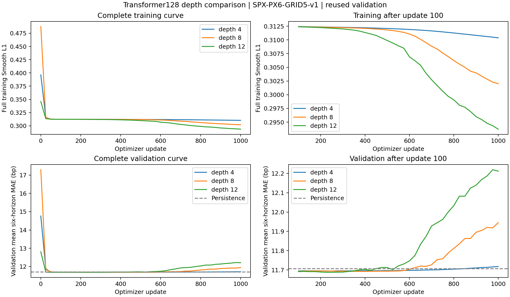

# Does Transformer depth improve validation MAE?

Owner Nicole. `none+Transformer128x4~none~none`, `none+Transformer128x8~none~none`, and `none+Transformer128x12~none~none @ train:SPX-PX6-GRID5-v1 → score:SPX-PX6-GRID5-v1 val`. All fits completed 1,000 full-batch updates. The new concurrent job exited 0 in 2h22m10s. No reserved test or text experiment.

## Finding

Depth12 has the lowest selected validation point estimate, but improves over depth4 by only **0.00219750 bp (0.0188%)**. The paired ten-date-block 95% interval for this gain is **[-0.00681032, +0.01309204] bp**, spanning zero. Depth8 is slightly worse than depth4. The comparison does not establish a reliable validation gain from greater depth under this recipe.

| Depth | Parameters | Selected update | Best mean validation MAE, bp | Final-update validation MAE, bp | Final training Smooth L1 |
|---|---:|---:|---:|---:|---:|
| 4 | 794,241 | 50 | 11.689790 | 11.717759 | 0.310381 |
| 8 | 1,587,329 | 100 | 11.692259 | 11.944967 | 0.302013 |
| 12 | 2,380,417 | 225 | 11.687593 | 12.212058 | 0.293715 |

Persistence mean six-horizon MAE on these same rows is 11.706526 bp. Lower MAE is better. The primary score averages all six cumulative-return endpoints (+5/+10/+15/+20/+25/+30 minutes).

## Per-horizon validation MAE at selected checkpoints

| Depth | +5m | +10m | +15m | +20m | +25m | +30m |
|---|---:|---:|---:|---:|---:|---:|
| 4 | 6.556318 | 9.240523 | 11.198858 | 12.889228 | 14.414717 | 15.839098 |
| 8 | 6.557018 | 9.240264 | 11.201123 | 12.891640 | 14.420487 | 15.843021 |
| 12 | 6.556437 | 9.236561 | 11.194363 | 12.885086 | 14.415535 | 15.837572 |

## Fixed inputs and training

Only Transformer layer count changes. Width128, heads4, FFN512, dropout0.1, 35 historical OHLC bars, shared learned query expanded over six temporal positions, linear input/readout, actual elapsed-time PE, preprocessing/scales, objective, precision, full batch204,694, 1,000-update optimizer/LR schedule and checkpoint criterion stay fixed. All 204,694 training windows and 40,548 validation windows are identical; train/validation share zero price bars. [Protocol](../../experiments/transformer-depth-sweep-v2/README.md).

Depth4 reuses the completed immutable reference. Depth8/12 started concurrently on one H200. The canceled sequential attempt is excluded. Each new fit passed the exact full-batch ten-update confirmation. The controller stops a sibling on failure and compares only completed 1,000-update runs. Equal update/sample budgets do not mean equal FLOPs; elapsed runtimes include contention and cannot isolate depth scaling efficiency.

## Training behavior

Deeper fits reached lower full-training losses, while late validation deterioration was larger. The selected checkpoints occur well before the final update. These curves show increased fitting capacity without a clear improvement in the selected validation forecasts; they do not show a training-loss plateau or justify extending training alone.

## Uncertainty and provenance

All paired mean-MAE 5-/10-date-block intervals for8vs4,12vs4,12vs8 span zero. The six individual horizon intervals are in [metrics.json](metrics.json); avoid selecting one favorable endpoint after inspecting them. Checkpoints and depth were chosen on reused validation. These conditional intervals do not adjust checkpoint/depth selection and are not independent test evidence. Each depth has one fit under this optimization recipe; a general claim about depth or different optimizers is outside this comparison.

Nineteen focused tests passed before launch. All 29 collected artifacts passed remote-to-local SHA256 checks. The paired comparison was re-executed locally and all output metrics agreed within numerical tolerance (largest observed difference 1.78e-15); data alignment/scales, source and checkpoint hashes, and 1,000 contiguous new-fit update logs were verified. [Provenance](provenance.json). Raw predictions, weights and optimizer states remain private. PR74 is stacked on73→72; main/Research Home verification awaits review and merge.
